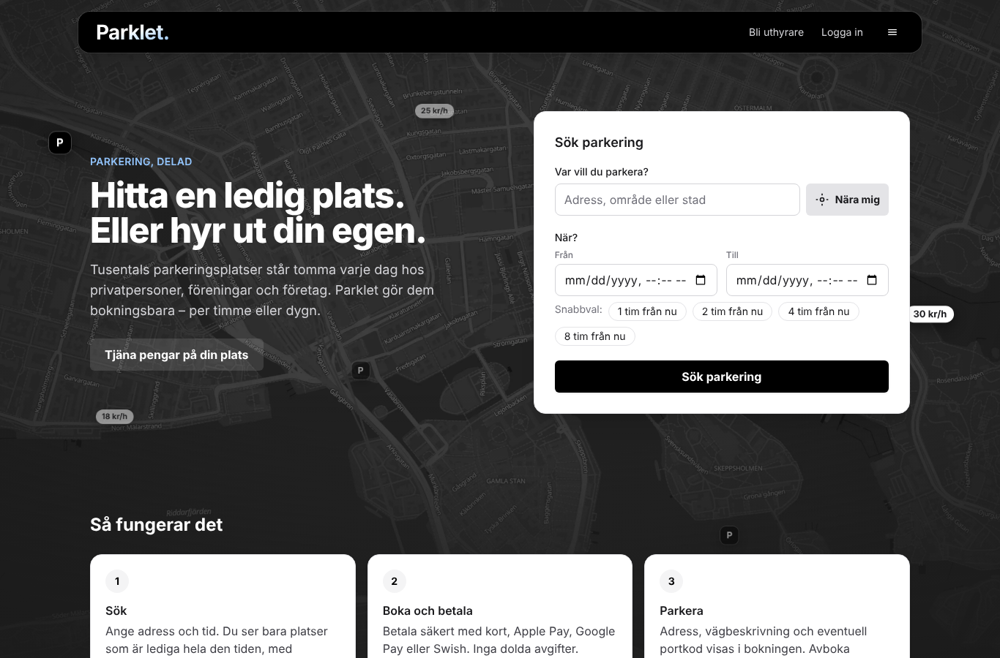

# Parklet

A rebuild of [parklet.se](https://www.parklet.se), a marketplace where people and
organisations rent out their parking spots when they're not using them.

- **[docs/01-rapport.md](docs/01-rapport.md)** (in Swedish, for Parklet's owner): the review
  of the current site (16 findings, prioritised), how the rebuild fixes each one, and the
  technical overview: stack and why, data and security, the right-to-rent, payment and
  vehicle-registration rules, integrations, tests, and the steps left before launch.
- **[docs/04-emails.md](docs/04-emails.md)**: every e-mail and notification.
- **[docs/05-testplan.md](docs/05-testplan.md)**: manual test plan for the main flows.



## Quick start

Requirements: Node.js 22+ and PostgreSQL 14+ with the `btree_gist` extension (it ships with
`postgresql-contrib` and the official Docker image).

```bash
docker compose up -d db          # or use your own Postgres
cp .env.example .env
npm install
node scripts/postgrest.mjs --print-key   # put it in .env as SUPABASE_SERVICE_ROLE_KEY
npm run db:api                   # Supabase's HTTP API for the local database (keep it running)
npm run db:migrate
npm run db:seed                  # demo data; prints the demo accounts
npm run dev                      # http://localhost:3000
```

The app reaches its data only through Supabase's HTTP API (PostgREST), as on production.
`npm run db:api` downloads the PostgREST version Supabase runs (once, into `node_modules/.cache`)
and creates Supabase's roles (`anon`, `authenticated`, `service_role`, `authenticator`). That
needs a database superuser the first time, which the Docker database's `parklet` user is; with
your own Postgres run `psql -U postgres -f scripts/api-roles.sql` once.

Demo accounts (password `parklet-demo-1`):

| Email | Role |
|---|---|
| `forare@parklet.test` | Driver with upcoming bookings |
| `anna@parklet.test` | Private host |
| `styrelsen@parklet.test` | Brf Linnéstaden (requires vehicle registration) |
| `erik@parklet.test` | Private host and administrator of a property company |
| `ny@parklet.test` | New host who hasn't verified or connected payouts |
| `admin@parklet.test` | Parklet reviewer (`/admin`) |

The demo set is defined once, in `src/server/demo-data.ts`. `npm run db:seed` wipes the data and
loads it; so does **Återställ testdata** at `/admin/testdata`, which admins get on the demo
deployment (`NEXT_PUBLIC_DEMO=1`) and in development, not in a real production. Both keep every
admin whose address can receive mail (not `@parklet.test`, `@example.com` and the like): their
user row stays as it is (password, BankID identity, admin flag), the session that pressed the
button too, and everything else they had is removed with the rest. `app_secrets` stays. The
old documents' files are removed from the store and the demo's PDF is stored again.

Payments and payout onboarding run in **test mode** (clearly marked in the UI). BankID uses
Idura when configured (see Deployment) and an instant mock otherwise.
Emails are printed to the server log and appended to `storage/outbox.jsonl`, so you can
follow approval, invitation and reset links locally.

## Scripts

| Command | |
|---|---|
| `npm run dev` / `build` / `start` | Next.js |
| `npm run lint` / `typecheck` | ESLint, TypeScript |
| `npm test` | Unit + integration tests (needs `parklet_test` database; set `TEST_DATABASE_URL` to override). Starts its own PostgREST |
| `npm run test:e2e` | Playwright against a production build (`npm run build` first; uses `parklet_e2e` database) |
| `npm run test:live` | Against real external services (Bolagsverket); needs `BOLAGSVERKET_CLIENT_ID`/`_SECRET`, skips without. In CI: the weekly "Live integrations" workflow, from repository secrets |
| `npm run db:generate` | Generate a migration after changing `src/db/schema.ts` |
| `npm run db:migrate` / `db:seed` | Apply migrations / load demo data |
| `npm run db:api` | Serve the local database through PostgREST on port 3300 |

## Deployment (Vercel + Supabase, Stockholm)

Live demo: **https://parklet-rebuild.vercel.app**

- **Database:** Supabase project `parklet` in `eu-north-1` (Stockholm). Migrations are applied;
  RLS is enabled on every table with no policies, so the public (`anon`) key can't read
  anything. Parklet's functions are executable by `service_role` only.
- **App:** Vercel, with functions pinned to `arn1` (Stockholm) in `vercel.json`.
- **Data access:** over Supabase's HTTP API (PostgREST) with the service key, from the server
  only (`src/db/api.ts`), like the other Supabase projects. No database connections from Vercel,
  so the connection pooler (Supavisor) is out of the picture: it made requests hang (#8–#13).
  Steps that must be all-or-nothing (bookings, spots with their opening hours, accounts with
  their owner, invitations, password resets, landlord answers) and the admin searches are
  Postgres functions in `src/db/migrations/0010_http_api.sql`. Reads are retried once on a
  network or gateway error; every request has a 15 s limit. The Supabase ↔ Vercel integration
  provides `SUPABASE_URL` and the service key (`SUPABASE_SECRET_KEY`, preferred, or the legacy
  `SUPABASE_SERVICE_ROLE_KEY`).
- **Documents** (ownership proofs, contracts, board minutes) are kept in the private Supabase
  Storage bucket `documents` (4 MB limit, PDF and images only, no public access), reached with the
  service key from the Supabase integration.
- **Vercel env:** `DOCUMENT_STORAGE=supabase`, `NEXT_PUBLIC_DEMO=1`. Links use `APP_URL` if
  set, otherwise Vercel's production or deployment URL.
- **Mail:** every mail lands in the `mail_outbox` table, readable by admins at `/admin/epost`.
  With `RESEND_API_KEY` and `MAIL_FROM` set, mail to real addresses is also sent through
  [Resend](https://resend.com); the demo accounts' `@parklet.test` addresses are never sent.
- **Demo accounts** on production use the password `parklet-demo-1` (they were seeded with
  random ones, `SEED_PASSWORD=random`, and reset for testing). An admin can also take one over
  with "Glömt lösenord" and the outbox. To start testing over, an admin presses **Återställ
  testdata** at `/admin/testdata`: the demo set as the seed makes it, with `parklet-demo-1`
  (`SEED_PASSWORD` applies to the CLI seed only), keeping admins with a real address.
- **BankID (Idura):** set `IDURA_ISSUER` (`https://<your-domain>.idura.broker`),
  `IDURA_CLIENT_ID`, `IDURA_CLIENT_SECRET` and `IDENTITY_ENCRYPTION_KEY` in Vercel. In Idura,
  the application is a *Regular Web Application* with *OAuth2 Code Flow* enabled and the redirect
  URL `https://parklet-rebuild.vercel.app/konto/verifiera/callback`. Without these variables
  the demo keeps the instant mock. The e2e tests run the real flow against `e2e/fake-idp.mjs`.
- **Bolagsverket (free company register API):** set `BOLAGSVERKET_CLIENT_ID` and
  `BOLAGSVERKET_CLIENT_SECRET` (plus `BOLAGSVERKET_ENV=test` for their test environment). New
  association and company accounts are then checked against the register: unknown and
  deregistered numbers are refused, the registered name is used, and admins see the result.
  Without credentials the check is skipped. The e2e tests use `e2e/fake-bolagsverket.mjs`.
- **Stuck queries:** pg_cron job `parklet-end-stuck-queries` ends queries stuck for over
  2 minutes every 5 minutes and tells admins in the bell (`scripts/supabase-stuck-queries.sql`,
  applied by hand on Supabase). With the HTTP API it is a last safety net.
- **Reminders:** Supabase's pg_cron calls `/api/cron/paminnelser` every 10 minutes (job
  `parklet-reminders`, via pg_net). It authenticates with the `cron` row in `app_secrets`, a
  token generated inside the database, so there is no secret to copy into Vercel.
- **Maps:** MapLibre with OpenFreeMap's vector tiles, recoloured by `src/lib/map-style.ts`.
  MapLibre itself is served from `public/maplibre/` (copied on `npm install`).
- **Future migrations:**
  `DATABASE_URL=<Supabase session pooler URL> npm run db:migrate`
  (the Drizzle journal on Supabase is up to date). Functions a migration creates must revoke
  `EXECUTE` from `PUBLIC`, `anon` and `authenticated`, as 0010 does; `tests/integration/api.test.ts`
  checks it.

## Configuration

See [.env.example](.env.example). Before a real launch, production needs Resend set up with
a verified sending domain, and the payment
and e-ID integrations described in `docs/01-rapport.md` (section 4.9).
