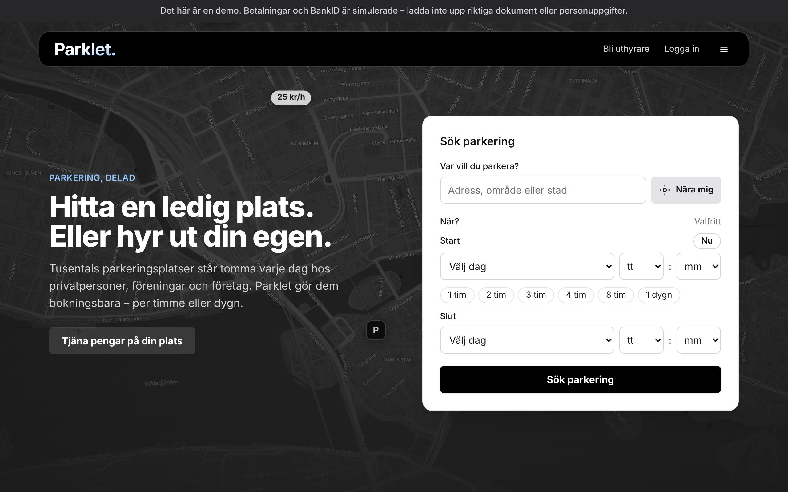

# Parklet

A rebuild of [parklet.se](https://www.parklet.se), a marketplace where people and
organisations rent out their parking spots when they're not using them.

- **[docs/01-rapport.md](docs/01-rapport.md)** (in Swedish, for Parklet's owner): the review
  of the current site (16 findings, prioritised), how the rebuild fixes each one, and the
  technical overview: stack and why, data and security, the right-to-rent, payment and
  vehicle-registration rules, integrations, tests, and the steps left before launch.
  Also as a PDF with the screenshots embedded, [docs/01-rapport.pdf](docs/01-rapport.pdf):
  rebuild it with `npm run docs:pdf` after changing the report. The screenshots of the new
  version (`docs/images/flow-*.jpg`) are taken from the demo data.
- **[docs/04-emails.md](docs/04-emails.md)**: every e-mail and notification.
- **[docs/05-testplan.md](docs/05-testplan.md)**: manual test plan for the main flows.



## Quick start

Requirements: Node.js 22+ and PostgreSQL 14+ with the `btree_gist` extension (it ships with
`postgresql-contrib` and the official Docker image).

```bash
docker compose up -d db          # or use your own Postgres
cp .env.example .env
npm install
node scripts/postgrest.mjs --print-key   # put it in .env as SUPABASE_SERVICE_ROLE_KEY
npm run db:api                   # Supabase's HTTP API for the local database (keep it running)
npm run db:migrate
npm run db:seed                  # demo data; prints the demo accounts
npm run dev                      # http://localhost:3000
```

The app reaches its data only through Supabase's HTTP API (PostgREST), as on production.
`npm run db:api` downloads the PostgREST version Supabase runs (once, into `node_modules/.cache`)
and creates Supabase's roles (`anon`, `authenticated`, `service_role`, `authenticator`). That
needs a database superuser the first time, which the Docker database's `parklet` user is; with
your own Postgres run `psql -U postgres -f scripts/api-roles.sql` once.

Demo accounts (password `parklet-demo-1`):

| Email | Role |
|---|---|
| `forare@parklet.test` | Driver with upcoming bookings |
| `anna@parklet.test` | Private host |
| `styrelsen@parklet.test` | Brf Linnéstaden (requires vehicle registration) |
| `erik@parklet.test` | Private host and administrator of a property company |
| `ny@parklet.test` | New host who hasn't verified or connected payouts |
| `admin@parklet.test` | Parklet reviewer (`/admin`) |

The demo set is defined once, in `src/server/demo-data.ts`. `npm run db:seed` wipes the data and
loads it; so does **Återställ testdata** at `/admin/testdata`, which admins get on the demo
deployment (`NEXT_PUBLIC_DEMO=1`) and in development, not in a real production. Both keep every
admin whose address can receive mail (not `@parklet.test`, `@example.com` and the like): their
user row stays as it is (password, BankID identity, admin flag), the session that pressed the
button too, and everything else they had is removed with the rest. `app_secrets` stays. The
old documents' files are removed from the store and the demo's PDF is stored again.

Payments and payout onboarding run in **test mode** (clearly marked in the UI): locally an
instant mock by default, or Stripe's test mode with `PAYMENT_PROVIDER=stripe` (see
[Payments](#payments-stripe-connect)). BankID uses
Idura when configured (see Deployment) and an instant mock otherwise.
Emails are printed to the server log and appended to `storage/outbox.jsonl`, so you can
follow approval, invitation and reset links locally.

## Scripts

| Command | |
|---|---|
| `npm run dev` / `build` / `start` | Next.js |
| `npm run lint` / `typecheck` | ESLint, TypeScript |
| `npm test` | Unit + integration tests (needs `parklet_test` database; set `TEST_DATABASE_URL` to override). Starts its own PostgREST |
| `npm run test:e2e` | Playwright against a production build (`npm run build` first; uses `parklet_e2e` database) |
| `npm run test:live` | Against real external services: Bolagsverket (needs `BOLAGSVERKET_CLIENT_ID`/`_SECRET`) and Stripe's test mode (needs a test `STRIPE_SECRET_KEY`); each skips without. In CI: the weekly "Live integrations" workflow, from repository secrets (`STRIPE_TEST_SECRET_KEY` for Stripe) |
| `npm run db:generate` | Generate a migration after changing `src/db/schema.ts` |
| `npm run db:migrate` / `db:seed` | Apply migrations / load demo data |
| `npm run db:api` | Serve the local database through PostgREST on port 3300 |

## Deployment (Vercel + Supabase, Stockholm)

Live demo: **https://parklet-rebuild.vercel.app**

- **Database:** Supabase project `parklet` in `eu-north-1` (Stockholm). Migrations are applied;
  RLS is enabled on every table with no policies, so the public (`anon`) key can't read
  anything. Parklet's functions are executable by `service_role` only.
- **App:** Vercel, with functions pinned to `arn1` (Stockholm) in `vercel.json`.
- **Data access:** over Supabase's HTTP API (PostgREST) with the service key, from the server
  only (`src/db/api.ts`), like the other Supabase projects. No database connections from Vercel,
  so the connection pooler (Supavisor) is out of the picture: it made requests hang (#8–#13).
  Steps that must be all-or-nothing (bookings, spots with their opening hours, accounts with
  their owner, invitations, password resets, landlord answers) and the admin searches are
  Postgres functions in `src/db/migrations/0010_http_api.sql`. Reads are retried once on a
  network or gateway error; every request has a 15 s limit. The Supabase ↔ Vercel integration
  provides `SUPABASE_URL` and the service key (`SUPABASE_SECRET_KEY`, preferred, or the legacy
  `SUPABASE_SERVICE_ROLE_KEY`).
- **Documents** (ownership proofs, contracts, board minutes) are kept in the private Supabase
  Storage bucket `documents` (4 MB limit, PDF and images only, no public access), reached with the
  service key from the Supabase integration.
- **Vercel env:** `DOCUMENT_STORAGE=supabase`, `NEXT_PUBLIC_DEMO=1`. Links use `APP_URL` if
  set, otherwise Vercel's production or deployment URL.
- **Payments:** the demo runs the mock until `PAYMENT_PROVIDER=stripe` and the Stripe keys are
  set; the steps are under [Payments](#payments-stripe-connect). The return URLs Parklet gives
  Stripe (after paying, cancelling, onboarding) follow `APP_URL` (or Vercel's URL).
- **Mail:** every mail lands in the `mail_outbox` table, readable by admins at `/admin/epost`
  (filtered by type and organisation, from the `kind` and `host_account_id` it is stored with).
  With `RESEND_API_KEY` and `MAIL_FROM` set, mail to real addresses is also sent through
  [Resend](https://resend.com); the demo accounts' `@parklet.test` addresses are never sent.
- **Demo accounts** on production use the password `parklet-demo-1` (they were seeded with
  random ones, `SEED_PASSWORD=random`, and reset for testing). An admin can also take one over
  with "Glömt lösenord" and the outbox. To start testing over, an admin presses **Återställ
  testdata** at `/admin/testdata`: the demo set as the seed makes it, with `parklet-demo-1`
  (`SEED_PASSWORD` applies to the CLI seed only), keeping admins with a real address.
- **BankID (Idura):** set `IDURA_ISSUER` (`https://<your-domain>.idura.broker`),
  `IDURA_CLIENT_ID`, `IDURA_CLIENT_SECRET` and `IDENTITY_ENCRYPTION_KEY` in Vercel. In Idura,
  the application is a *Regular Web Application* with *OAuth2 Code Flow* enabled and the redirect
  URL `https://parklet-rebuild.vercel.app/konto/verifiera/callback`. Without these variables
  the demo keeps the instant mock. The e2e tests run the real flow against `e2e/fake-idp.mjs`.
- **Bolagsverket (free company register API):** set `BOLAGSVERKET_CLIENT_ID` and
  `BOLAGSVERKET_CLIENT_SECRET` (plus `BOLAGSVERKET_ENV=test` for their test environment). New
  association and company accounts are then checked against the register: unknown and
  deregistered numbers are refused, the registered name is used, and admins see the result.
  Without credentials the check is skipped. The e2e tests use `e2e/fake-bolagsverket.mjs`.
- **Stuck queries:** pg_cron job `parklet-end-stuck-queries` ends queries stuck for over
  2 minutes every 5 minutes and tells admins in the bell (`scripts/supabase-stuck-queries.sql`,
  applied by hand on Supabase). With the HTTP API it is a last safety net.
- **Reminders:** Supabase's pg_cron calls `/api/cron/paminnelser` every 10 minutes (job
  `parklet-reminders`, via pg_net). It authenticates with the `cron` row in `app_secrets`, a
  token generated inside the database, so there is no secret to copy into Vercel.
- **Maps:** MapLibre with OpenFreeMap's vector tiles, recoloured by `src/lib/map-style.ts`.
  MapLibre itself is served from `public/maplibre/` (copied on `npm install`).
- **Future migrations:**
  `DATABASE_URL=<Supabase session pooler URL> npm run db:migrate`
  (the Drizzle journal on Supabase is up to date). Functions a migration creates must revoke
  `EXECUTE` from `PUBLIC`, `anon` and `authenticated`, as 0010 does; `tests/integration/api.test.ts`
  checks it.

## Payments (Stripe Connect)

Parklet never holds drivers' money: Stripe does, under its licence, and pays the hosts. Code:
`src/server/payments.ts` (provider boundary), `checkout.ts` (paying a booking), `payouts.ts`
(hosts' accounts), `stripe-webhooks.ts` and `src/app/api/stripe/webhook/route.ts`.

- **Hosts** get a Stripe **Express** connected account (Sweden, SEK): `individual` for
  households, `non_profit` for associations (BRFs have a board and no owners), `company` for
  companies, prefilled with e-mail, the BankID name or the organisation's name and org.nr.
  Stripe's hosted onboarding does identity, bank account and AML checks. Parklet's
  `payout_status` follows Stripe: `onboarding` (details not submitted), `pending` (Stripe is
  verifying), `restricted` (Stripe needs more), and `active` only while Stripe reports charges
  **and** payouts enabled; only active accounts' spots can be booked. It follows the
  `account.updated` webhook and is checked again when the host comes back from Stripe and while
  the dashboard shows a pending account. Only the account's owner connects payouts; once
  connected the owner can open Stripe's Express dashboard ("Öppna Stripe").
- **Drivers** pay on Stripe's hosted **Checkout** (Swedish, SEK, amounts in öre; card, Apple Pay,
  Google Pay and whatever else is switched on in Stripe). It is a **destination charge**: the
  PaymentIntent is on Parklet's account, `transfer_data.destination` is the host's account and
  `application_fee_amount` is Parklet's service fee, so the host gets the parking price and
  Parklet keeps the fee, less Stripe's processing fee (Parklet pays Stripe's fees).
- **Hold and session lifetimes.** A booking holds its slot for 15 minutes on the summary page.
  When the driver goes on to pay, the hold moves to the Checkout Session's expiry, 31 minutes
  (Stripe's minimum is 30): the slot is the driver's for exactly as long as Stripe can take the
  payment, and is released by `checkout.session.expired`, or by the hold running out if that
  webhook never arrives. Pressing "Betala" again reuses the open session. A payment that still
  arrives for a released booking is kept if the slot is free and refunded in full if someone
  else has it: the database's exclusion constraint decides, so there is never a double booking.
- **Confirmation** happens on the return URL (`/betala/<id>/klar`, from Stripe's own record of
  the session) and from the webhook, whichever comes first; both are idempotent, and handled
  events are recorded in `stripe_events`.
- **Refunds** on cancellation follow the cancellation rules (always the full amount) and go
  through Stripe with `reverse_transfer` and `refund_application_fee`, so the host's share and
  Parklet's fee both go back. A refund made in Stripe's dashboard ends the booking; a refund that
  fails later puts the booking back to "cancelled, paid" and tells the admins.

### Setting up Stripe (test mode)

1. In the Stripe dashboard (test mode), **Connect → Get started**: choose *Platform or
   marketplace*, with Express accounts, Stripe handling onboarding, the platform paying fees and
   being responsible for refunds and disputes (losses). Under **Settings → Connect → Branding**
   set Parklet's name, icon and colour (Express onboarding shows them), and under **Settings →
   Connect → Onboarding options / Countries** allow Sweden.
2. **Settings → Payments → Payment methods**: switch on what Checkout should offer (cards,
   Apple Pay, Google Pay, Klarna…). Methods that settle later work too: the booking waits for
   `checkout.session.async_payment_succeeded`.
3. **Developers → API keys**: the secret key `sk_test_…` is `STRIPE_SECRET_KEY`. No publishable
   key is needed (Checkout is hosted).
4. **Developers → Webhooks**, two endpoints with the URL `https://<domain>/api/stripe/webhook`:
   - *Events on your account*: `checkout.session.completed`,
     `checkout.session.async_payment_succeeded`, `checkout.session.async_payment_failed`,
     `checkout.session.expired`, `charge.refunded`, `refund.failed`, `refund.updated`.
   - *Events on Connected accounts*: `account.updated`.

   Each endpoint has its own signing secret; put both in `STRIPE_WEBHOOK_SECRET`,
   comma-separated (`whsec_account,whsec_connect`).
5. In Vercel (Production and Preview as needed): `PAYMENT_PROVIDER=stripe`,
   `STRIPE_SECRET_KEY`, `STRIPE_WEBHOOK_SECRET`, then redeploy. With `PAYMENT_PROVIDER=stripe` a
   missing key is an error (bookings and the webhook fail loudly), never a fall-back to the mock;
   the mock itself is refused in production unless `NEXT_PUBLIC_DEMO=1`.
6. Demo data seeded under the mock has mock payout accounts (`acct_mock_…`), which Stripe can't
   pay. Press **Återställ testdata** once after switching: the demo hosts then start unconnected,
   or all get `STRIPE_TEST_CONNECTED_ACCOUNT` when it is set (a test account connected through the
   app's own onboarding). A mock account left over anyway is disconnected the first time a
   checkout or the host's dashboard meets it, so its spots leave search instead of failing at
   **Betala**. By hand:
   `update host_accounts set payout_status = 'not_connected', payout_account_ref = null where payout_account_ref like 'acct_mock_%';`

Going live later means the same steps in live mode (live keys, live webhook endpoints, Connect
activated for the live account), with Stripe's platform agreement and Parklet's terms in place.

**Locally** with the [Stripe CLI](https://docs.stripe.com/stripe-cli):

```bash
stripe login
stripe listen --forward-to localhost:3000/api/stripe/webhook --forward-connect-to localhost:3000/api/stripe/webhook
# prints whsec_…: STRIPE_WEBHOOK_SECRET (one secret covers both)
PAYMENT_PROVIDER=stripe STRIPE_SECRET_KEY=sk_test_… STRIPE_WEBHOOK_SECRET=whsec_… npm run dev
stripe trigger checkout.session.completed   # or pay with the test cards below
```

Test data: card `4242 4242 4242 4242` (any future date, any CVC), 3-D Secure
`4000 0027 6000 3184`, declined `4000 0000 0000 0002`. In Express onboarding (test mode): phone
`000 000 0000` with SMS code `000000`, Swedish test bank account (IBAN) `SE3550000000054910000003`,
date of birth `1901-01-01` and address line `address_full_match` (both verify), ID number
`000000000` where Stripe accepts it, and "Use test document" when it asks for an ID document
(Stripe's "Testing Connect" page lists the current values).

The e2e tests run all of this against `e2e/fake-stripe.mjs` (the SDK pointed at it with
`STRIPE_API_BASE`, a test-only variable refused together with a live key); the integration
tests in `tests/integration/stripe-*.test.ts` cover the webhook handling, holds, late payments,
refunds and payout statuses, and `tests/live/stripe.test.ts` makes the same requests against
Stripe's test mode.

## Handing over to another organisation

Everything is configured through environment variables (`.env.example` lists them all).
Secrets to move or rotate when the project changes hands:

| Secret | Where it comes from | On handover |
|---|---|---|
| `SUPABASE_SECRET_KEY` / `SUPABASE_SERVICE_ROLE_KEY` | Supabase project (via the Vercel integration) | Rotate in Supabase after transferring the project |
| `STRIPE_SECRET_KEY` | Stripe → Developers → API keys | Roll the key in Stripe |
| `STRIPE_WEBHOOK_SECRET` | Stripe → Developers → Webhooks (both endpoints) | Roll each endpoint's secret, or recreate the endpoints on the new domain |
| `IDURA_CLIENT_SECRET` | Idura application | Rotate in Idura |
| `IDENTITY_ENCRYPTION_KEY` | Generated (`openssl rand -base64 32`) | **Move, don't rotate**: the stored personnummer can only be read with it |
| `BOLAGSVERKET_CLIENT_SECRET` | Bolagsverket API registration | Re-register under the new organisation |
| `RESEND_API_KEY` | Resend | New key in the new organisation's Resend account (and a verified domain) |
| `CRON_SECRET` (if used) | Generated | Rotate; the database's own `cron` token in `app_secrets` can stay |
| `STRIPE_TEST_SECRET_KEY` (GitHub secret) | Stripe test mode | Replace in the repository's secrets |

**Stripe is the one piece that doesn't move by copying keys:** hosts' connected accounts belong
to Parklet's Stripe platform account. Hand over that Stripe account itself (add the new owners
in Stripe's team settings and transfer ownership, update the business details and bank
account), rather than starting a new one: with a new platform account every host would have to
connect payouts again, and payments made on the old one are refunded there.

## Configuration

See [.env.example](.env.example). Before a real launch, production needs Resend set up with
a verified sending domain, Stripe in live mode (see [Payments](#payments-stripe-connect)) and
the e-ID integration described in `docs/01-rapport.md` (section 4.9).
