# Parklet: granskning av dagens tjänst och den nya versionen

*Oktober 2026. Granskningen av parklet.se gjordes den 15 oktober 2026; beskrivningen av den
nya versionen gäller koden den 21 oktober 2026.*

Rapporten har fyra delar. De tre första är skrivna för den som driver Parklet och kräver inga
tekniska förkunskaper. Den fjärde är den tekniska beskrivningen, för den som ska ta över,
granska eller bygga vidare på systemet.

1. [Sammanfattning](#1-sammanfattning)
2. [Problemen i dagens Parklet](#2-problemen-i-dagens-parklet)
3. [Så löser den nya versionen dem](#3-så-löser-den-nya-versionen-dem)
4. [Teknisk översikt av den nya MVP:n](#4-teknisk-översikt-av-den-nya-mvpn)

---

## 1. Sammanfattning

**Vad som granskats.** Den publika delen av www.parklet.se, informationssajten
info.parklet.se och den kod som webbläsaren laddar ner för uthyrarflödet. Allt som kräver
inloggning (bokning, betalning, uthyrarens översikt) kunde inte provas i praktiken; det som
sägs om uthyrarflödet bygger på texter och anrop i den nedladdade koden.

**De viktigaste problemen.** Dagens Parklet går i praktiken inte att använda som
marknadsplats. I hela Sverige finns **en enda parkeringsplats**, och den är stängd. Det saknas
**användarvillkor, integritetspolicy och företagsuppgifter**, samtidigt som uthyrare ombeds
skriva in sitt personnummer i en vanlig textruta. Knapparna "Hyr ut plats" och "Till Parklet"
på informationssajten leder till en **domän som inte finns**. Platssökningen fungerar inte,
kartan visas bara till hälften och det går **inte att återställa ett glömt lösenord**. Tjänsten
körs dessutom på servrar **i USA**, uthyrarflödet visar utvecklarmeddelanden på engelska och
inloggningen kräver en separat identitetsapp i stället för BankID. Totalt redovisas **16
brister**, varav tre är affärskritiska.

**Vad den nya versionen åtgärdar.** Den nya versionen är en sammanhållen tjänst på en domän,
på svenska rakt igenom, med servrar i Stockholm. Alla 16 brister är åtgärdade. Därtill finns
det som en marknadsplats för parkering behöver för att vara pålitlig: uthyrare legitimerar sig
med BankID, varje plats granskas av Parklet innan den kan bokas, den som hyr sin plats måste
visa hyresvärdens eller bostadsrättsföreningens godkännande (som kan lämnas med ett klick från
ett e-postmeddelande), föreningar och företag kontrolleras mot Bolagsverket, och bilar som
måste registreras hos föreningen hanteras med påminnelser och sparas per plats. Dubbelbokningar
är omöjliga. Uthyrare har egna sökbara listor över sina parkeringsplatser, bokningar och e-post,
hanterar sina administratörer och kan ta bort platser och konton. Parklets administratörer har en
granskningskö, sökbara listor över platser, uthyrare och bokningar, en notisklocka, en logg över
all utgående e-post och en sammanfattning varje morgon.

**Vad som återstår före lansering.** Den nya versionen är en fungerande MVP (första
lanseringsbara version) som körs i testläge. Före en skarp lansering behöver betalningarna
(Stripe Connect, i testläge tills vidare) och BankID gå över i skarpt läge, e-post skickas från
en verifierad parklet.se-adress, villkor och integritetspolicy granskas av jurist, rutiner för
skatterapportering (DAC7) och moms på plats, felövervakning kopplas in och hela driften flyttas
till Parklets egna konton. Den viktigaste affärsfrågan kvarstår också: **utbudet**. Tjänsten
gör det lätt att hyra ut, men platserna måste fortfarande värvas. Se avsnitt
[4.9 Nästa steg före lansering](#49-nästa-steg-före-lansering).

---

## 2. Problemen i dagens Parklet

Varje brist har ett nummer (1–16) och en allvarlighetsgrad:

- **Kritisk**: hindrar affären i sig.
- **Allvarlig**: ett centralt flöde är trasigt eller inger inte förtroende.
- **Tydligt fel**: en klar brist som användare märker.
- **Finputs**: småfel.

| Nr | Brist | Grad |
|---|---|---|
| 1 | Det finns inget att boka: en enda plats i hela Sverige, och den är stängd | Kritisk |
| 2 | Inga villkor, ingen integritetspolicy, inget samtycke, men personnummer samlas in | Kritisk |
| 3 | "Hyr ut plats" och "Till Parklet" leder till en domän som inte finns | Kritisk |
| 4 | Platssökningen är trasig på tre sätt | Allvarlig |
| 5 | Kartan med sökresultat visas bara delvis | Allvarlig |
| 6 | Det går inte att återställa ett glömt lösenord | Allvarlig |
| 7 | Tjänsten körs i USA trots att alla användare finns i Sverige | Allvarlig |
| 8 | Uthyrarflödet visar utvecklar- och engelska felmeddelanden, och grupper sparas inte | Allvarlig |
| 9 | Två separata sajter med blandade språk och varumärken | Tydligt fel |
| 10 | Sökningen lämnar ut interna uppgifter och saknar gränser | Tydligt fel |
| 11 | Formulären saknar grundläggande kontroller och stöd för lösenordshanterare | Tydligt fel |
| 12 | Brister i tillgänglighet, och knappen för att bli uthyrare döljs i mobilen | Tydligt fel |
| 13 | Grundläggande sökmotoroptimering saknas | Tydligt fel |
| 14 | Amerikanskt datumformat, passerade tider och bara fyra veckors framförhållning | Tydligt fel |
| 15 | Samma data hämtas två gånger på varje sida | Finputs |
| 16 | Stavfel och omkastade siffror på informationssajten | Finputs |

Nedan är bristerna grupperade efter vad de betyder för affären.

### 2.1 Det finns inget att sälja (nr 1)

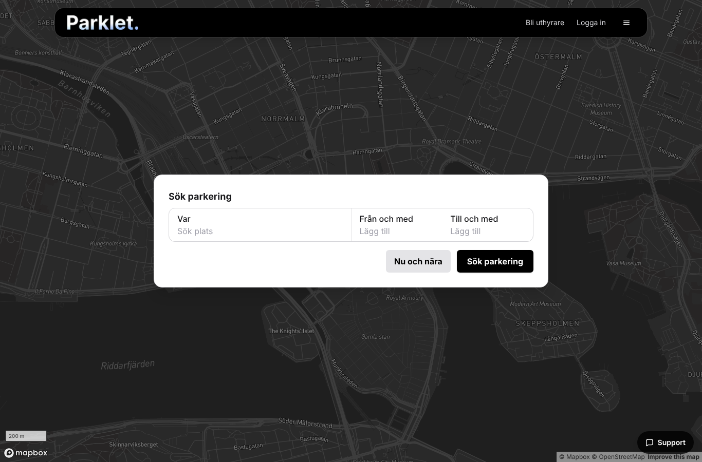

Sökningen som webbplatsen själv använder ger, med en sökradie på 200 mil över hela Sverige,
**en enda träff**: Odinslundsgatan 9 i Göteborg. Platsens enda tillgängliga period var 11–15
oktober, så i dag står den som "Stängt vid vald tid" och "Inget pris för vald tid".

Kartan öppnar dessutom över **Stockholm**, medan företaget och dess enda plats finns i
Göteborg. En förstagångsbesökare som klickar på "Sök parkering" möts av "Inga
parkeringsplatser kunde hittas" på en mörk, halvt utritad karta.

*Vad det betyder:* utan utbud finns ingen marknadsplats. Produkten måste göra det enkelt att
lägga upp en plats, och en tom sökning måste locka till uthyrning ("Har du en plats här? Hyr
ut den") i stället för att bara säga nej.

### 2.2 Juridik och regelefterlevnad (nr 2, 7)

**Grundläggande juridik saknas (nr 2, kritisk).**

- Sidorna för integritet och villkor (`/privacy`, `/terms`, `/integritetspolicy`, `/villkor`)
  finns inte på någon av domänerna. Företagsnamn, organisationsnummer och adress står
  ingenstans, fast e-handelslagen kräver att den som tillhandahåller tjänsten går att
  identifiera.
- Registreringsformuläret har ingen kryssruta för villkor eller integritetspolicy och länkar
  inte till någon av dem.
- Uthyrarflödet ber om **personnummer i en vanlig textruta** (med exemplet ÅÅÅÅMMDD-XXXX).
  Personnummer får bara behandlas när det är klart motiverat (dataskyddslagen 3 kap. 10 §), och
  det säkra sättet att få ett verifierat personnummer är via e-legitimation (BankID), inte genom
  att användaren skriver in det.

**Driften ligger i USA (nr 7, allvarlig).** www.parklet.se körs i Microsofts datacenter i
Virginia (Azure East US 2). För en tjänst där alla användare finns i Sverige innebär det:

- ungefär en tiondels sekund extra väntetid på varje sidvisning, och
- att personuppgifter (konton, registreringsnummer, positioner, personnummer) förs över till
  ett land utanför EU. Det kräver en rättslig grund för överföringen (EU–USA-ramverket eller
  standardavtalsklausuler) och måste framgå av integritetspolicyn, som alltså saknas.

En EU-region (till exempel Sverige eller Nordeuropa) kostar lika mycket.

### 2.3 Förtroende och säkerhet (nr 8, 10)

**Uthyrarflödet visar utvecklarmeddelanden och erkänner luckor (nr 8, allvarlig).** Koden för
uthyrarflödet innehåller bland annat:

- *"Select an organization before creating parking."*, på engelska i ett svenskt gränssnitt.
- *"Organisationen skapades, men backend-svaret saknade organisations-id."* och *"Organisationen
  finns redan, men dess organisations-id kunde inte hämtas."*: tekniska felmeddelanden som en
  användare inte kan göra något åt.
- *"Grupper hanteras i MVP-dashboarden. Fortsatt setup sker utan gruppsparning i detta steg."*
  Det betyder att grupper som uthyraren lägger upp **inte sparas**.

Flödets upplägg är i sig rimligt (kontotyp, egenbevis, plan, parkeringsområden med bevis på
att man äger eller hyr, schema, grupper). Det är utförandet och felhanteringen som brister.

Inloggningen bygger dessutom på **"Logga in med Access"**, en QR-kod för appen Neuro Access.
De flesta svenskar har BankID; att behöva skaffa en separat identitetsapp är en stor tröskel för
både förare och uthyrare.

**Sökningen lämnar ut mer än den borde (nr 10, tydligt fel).** Sökfunktionen, som vem som
helst kan anropa utan att logga in, returnerar Parklets interna regelverk för varje plats:
interna id-nummer, godkännandeläge, deposition, avbokningsgränser och schemadetaljer. Den
accepterar vilken sökradie som helst (200 mil fungerade) utan begränsning av antalet träffar.
Det gör det lätt för vem som helst att kopiera hela utbudet.

### 2.4 Användare som fastnar (nr 3, 4, 5, 6, 11, 14)

**Döda länkar (nr 3, kritisk).** I sidfoten på info.parklet.se leder **"Till Parklet"** till
app.parklet.nu och **"Hyr ut plats"** till app.parklet.nu/upload-parking. Domänen parklet.nu
finns inte, så länkarna leder ingenstans. Och **"Hyr ut en plats"** i sidhuvudet leder till
startsidan i stället för till uthyrarflödet. Den viktigaste knappen för att få in utbud
fungerar alltså inte.

**Platssökningen är trasig (nr 4, allvarlig).**

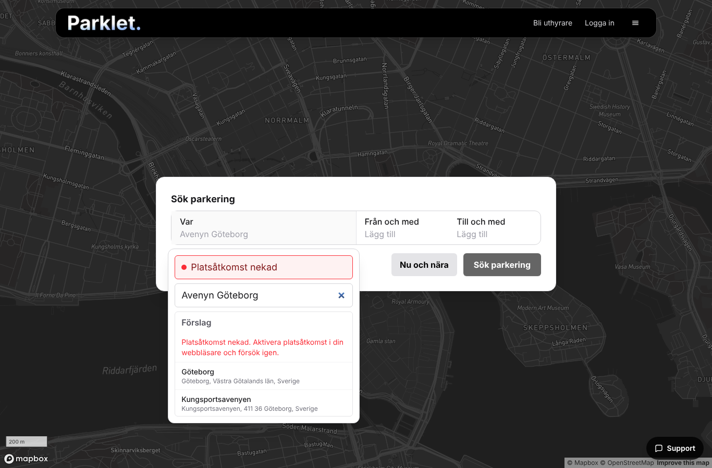

- **"Använd din plats" kan aldrig fungera.** Varje gång sökfältet får fokus försöker sidan
  översätta användarens position till en adress hos kartleverantören Mapbox. Anropet är felbyggt
  och nekas, fyra gånger per klick.
- **Ett klick på "Var" räcker inte.** Fältet är egentligen en knapp; det man skriver efter
  första klicket hamnar ingenstans och panelen säger "Inga förslag ännu". Man måste klicka en
  gång till.
- **"Platsåtkomst nekad" visas medan man skriver en adress**, fast användaren aldrig bett om att
  dela sin position. Två röda felrutor ligger ovanför fullt användbara förslag.

**Kartan visas bara delvis (nr 5, allvarlig).**

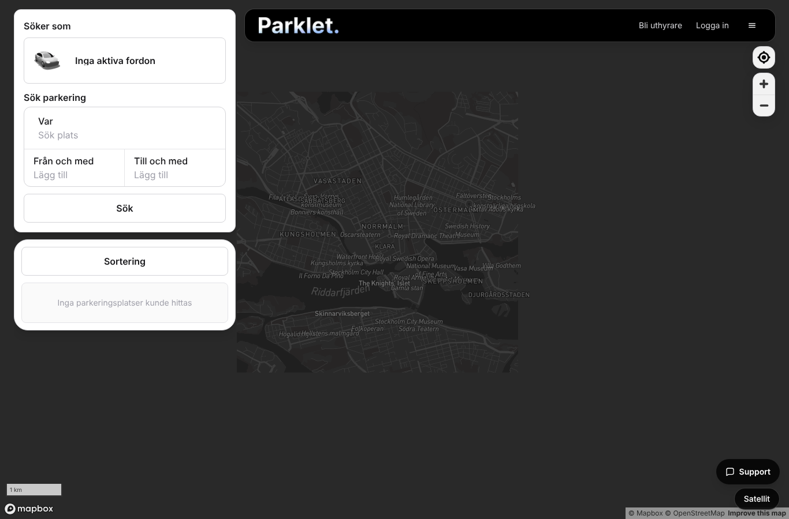

Efter "Sök parkering" är kartan en ruta på omkring 490 × 490 punkter mitt på skärmen, med tomt
utrymme runt omkring. Det är ett känt fel: kartan ritas innan sidan bestämt hur stor den ska
vara, och får aldrig veta att den ska rita om sig.

**Glömt lösenord går inte att lösa (nr 6, allvarlig).** Inloggningen saknar länken "Glömt
lösenord?" och sidorna för återställning finns inte, fast hjälpsidan har frågan "Jag har glömt
mitt lösenord, vad gör jag?". Varje glömt lösenord blir ett supportärende eller en förlorad
kund.

**Formulären (nr 11, tydligt fel).**

- Inloggning och registrering kontrollerar inte att fälten är ifyllda och visar inga fel vid
  fälten. Lösenordsfältet är inställt så att lösenordshanterare inte fungerar, och det står
  ingenstans hur långt lösenordet måste vara.
- Registreringen ber om för- och efternamn i separata fält men förklarar aldrig vad kontot ger,
  och saknar samtycke (se nr 2).

**Datum och tider (nr 14, tydligt fel).**

- "Nu och nära" fyller i starttiden som **10/15 · 13:15**, det amerikanska formatet
  månad/dag, i ett svenskt gränssnitt.
- Datumväljaren går bara fyra veckor framåt, och tidslistan börjar på 00:00 i dag, så den
  erbjuder tider som redan har passerat.

### 2.5 Varumärke, synlighet och tillgänglighet (nr 9, 12, 13, 16)

**Två sajter, två språk, två varumärken (nr 9, tydligt fel).**

- Appen (mörkt tema) och informationssajten (ljust tema, byggd i verktyget Framer) har olika
  meny, sidfot och formspråk. Appens startsida förklarar ingenting; all information finns på en
  annan adress.
- Appen talar om för webbläsare och sökmotorer att sidorna är **på engelska** och har engelsk
  titel och beskrivning ("Find space. Share space.") på svenska sidor. Vissa sidor är helt på
  engelska: översikten säger "You need to log in first." / "Go to login", och sidan för "finns
  inte" är ramverkets standardtext *"404: This page could not be found."*
- Nyhetsartiklarna heter **"… – My Framer Site"** i webbläsarfliken och i Googles träfflista.

**Tillgänglighet (nr 12, tydligt fel).**

- Sökfälten (Var, Från och med, Till och med) är egentligen knappar. En skärmläsare läser upp
  "knapp Var Sök plats", och det finns inget att skriva i förrän något öppnats.
- Blandade språk i det som läses upp ("Toggle attribution", "Öppna meny").
- I mobilen är knappen **"Bli uthyrare"** dold, alltså vägen in för marknadsplatsens utbudssida.
- Menyn för utloggade visar "Mina bokningar", "Mina fordon" och "Grupper", som inte fungerar
  utan konto, men inga länkar till hjälp, om oss eller villkor.

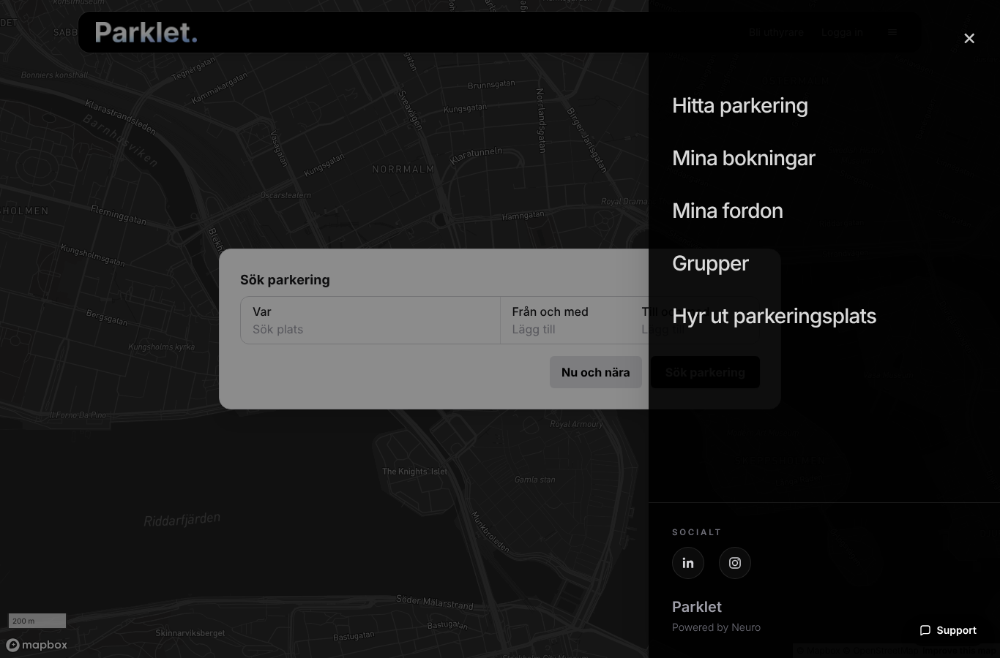

**Sökmotorer (nr 13, tydligt fel).** Filerna som talar om för sökmotorer vad som får indexeras
och vilka sidor som finns (`robots.txt`, `sitemap.xml`) saknas. Startsidan är en karta med en
dialogruta: ingen rubrik, ingen text, inga stadssidor. Varken sökmotorer eller människor kan se
vad tjänsten är eller var den finns. Bilderna på informationssajten saknar bildtexter för
skärmläsare och sökmotorer, och sajten ger ett JavaScript-fel när den laddas.

**Stavfel (nr 16, finputs).** På informationssajten:

- "Partille Tidning **repotage**" ska vara *reportage*, och rubriken saknar ett avslutande
  citattecken.
- Statistikrutorna har etikett och värde omkastade: "Av parkeringsplatser i städer / står 30 %
  tomma", "Förloras på att leta parkering / 15 min dagligen".
- "Vi sträcker oss från fastighetsägare tomma platser…" ska vara *fastighetsägares*.

### 2.6 Betalningar och prissättning (nr 10)

Betalflödet ligger bakom inloggning och kunde inte provas. Det som syns utifrån är
prissättningen: priserna ser mekaniskt framräknade ut (dygnspris = 24 × timpris = 360 kr,
månadspris 10 920 kr), så det finns i praktiken ingen rabatt för längre hyra.

Det viktiga att kontrollera i dagens lösning är **vem som håller pengarna**. Om Parklet tar emot
förarens betalning på ett eget konto och sedan betalar uthyraren är det en betaltjänst som
kräver tillstånd från Finansinspektionen. Den nya versionen undviker frågan helt (se avsnitt
4.4).

### 2.7 Administration och arbetsbelastning (nr 6, 8, 15)

Flera av bristerna landar till slut hos Parklet själva: varje glömt lösenord blir ett
supportärende (nr 6), organisationer som skapats till hälften och grupper som inte sparats måste
redas ut för hand (nr 8), och den som klickar på en död länk hör av sig eller försvinner (nr 3).
Det finns inga spår av något stöd för att granska uthyrare och deras rätt att hyra ut.

**Dubbla anrop (nr 15, finputs).** Varje sidvisning hämtar menyn två gånger, och varje sökning
hämtar fordon och sökresultat två gånger. Det kostar serverkapacitet och tyder på att samma data
hämtas på två ställen i koden.

---

## 3. Så löser den nya versionen dem

| Nr | Problem | I den nya versionen |
|---|---|---|
| 1 | Inget att boka | Startsidan förklarar tjänsten och värvar uthyrare. En tom sökning länkar till "Hyr ut den på Parklet". Demodata finns i fyra städer (Göteborg, Stockholm, Uppsala, Malmö). Sökningen visar platserna inom 3 km och under **Andra parkeringsplatser** de närmaste längre bort, så att minst tio platser visas när det finns så många. Filter för typ, tak och elbilsladdning |
| 2 | Juridik | Sidor för användarvillkor och integritetspolicy (utkast som ska granskas av jurist), kryssruta för samtycke vid registrering, personnummer hämtas via BankID och skrivs aldrig in |
| 3 | Döda länkar | En tjänst på en domän. Alla länkar kontrolleras av ett automatiskt test |
| 4 | Platssökning | Ett riktigt sökfält som går att skriva i direkt. Positionen används bara när man själv trycker på "Nära mig". Om adresstjänsten ligger nere går det fortfarande att söka på stad |
| 5 | Kartan | Kartan fyller sin yta och ritar om sig när fönstret ändras. Listan bredvid visar alltid samma resultat, så tjänsten går att använda även utan kartan |
| 6 | Glömt lösenord | Fullständig återställning via e-post, med en engångslänk |
| 7 | Drift i USA | Servrar och databas i Stockholm |
| 8 | Uthyrarflödet | Ett tydligt steg-för-steg-flöde med svenska meddelanden: BankID, utbetalningskonto, plats, underlag, granskning. Allt som fylls i sparas, och den som får ett fel behåller det som skrivits |
| 9 | Två sajter | En tjänst, svenska rakt igenom, egna svenska sidor för "finns inte" och för fel |
| 10 | Sökningen lämnar ut data | Sökningen returnerar bara det som visas på skärmen. Sökradien är fast och antalet träffar begränsat |
| 11 | Formulär | Fält med etiketter, felmeddelanden vid fältet, stöd för lösenordshanterare, minst 10 tecken, "visa lösenord" |
| 12 | Tillgänglighet | Riktiga inmatningsfält, genväg förbi menyn, synlig markering av vad som är valt, skärmläsaren får veta när pris och sökresultat ändras, inga dolda knappar i mobilen |
| 13 | Sökmotorer | Filerna för sökmotorer finns, svenska sidbeskrivningar, innehåll på startsidan, länkar till städer |
| 14 | Datum och tider | Svensk tid och svenskt format överallt, passerade tider erbjuds inte, bokning upp till två månader framåt. Sommar- och vintertid hanteras rätt |
| 15 | Dubbla anrop | Sökningen görs på servern, så webbläsaren hämtar inte samma uppgifter flera gånger |
| 16 | Stavfel | En separat informationssajt behövs inte längre; alla texter ligger i samma tjänst |

Därtill gör den nya versionen sådant som dagens Parklet inte gör alls. Så här upplevs den av de
tre grupperna som använder den.

Bilderna nedan är tagna i den nya versionen med demodata (demobannern överst visar att
betalningar och BankID är i testläge).

### Föraren

**1. Sök.** Föraren söker på adress, stad eller "Nära mig", med eller utan tid. Tiden väljs i
femminutersteg med snabbval för längden (1 tim, 2 tim … 1 dygn), och passerade tider erbjuds inte.


*Bild 1. Startsidan: sökningen direkt på första sidan, kartan i bakgrunden.*

**2. Välj en parkeringsplats.** Med en tid visas bara parkeringsplatser som är lediga **hela**
perioden, med totalpriset för just den tiden, både i listan och som prislappar på kartan. Först
kommer platserna inom 3 km; finns det färre än tio visas de närmaste längre bort under **Andra
parkeringsplatser**, så att föraren alltid ser minst tio när det finns så många. Filterknappar
över resultaten begränsar till en typ (garage, carport, uppfart, utomhusplats), till platser under
tak eller med elbilsladdning. Filtren gäller båda listorna, ligger i adressen och följer med till
en ny sökning.

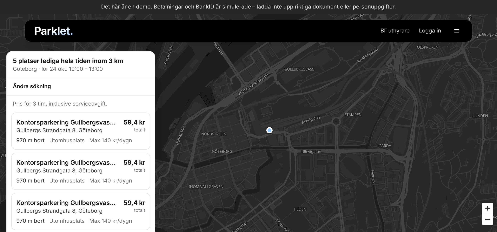
*Bild 2. Sökresultat i Göteborg för en vald tid: filterknappar och lista till vänster, prislappar
på kartan.*

**3. Se parkeringsplatsen och priset.** Platsen öppnas i en panel över kartan, så att föraren inte
tappar sin sökning. Panelen visar typ och egenskaper, öppettider i klartext ("mån–fre
07:00–18:00"), när platsen är upptagen, avbokningsvillkor och priset uppdelat på parkering och
serviceavgift. Länken till platsen kan kopieras och delas, med de valda tiderna.

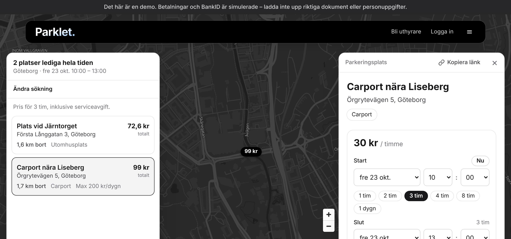
*Bild 3. Parkeringsplatsen med tidväljare och pris. Den som inte är inloggad loggar in och kommer
tillbaka hit med tiderna kvar.*

**4. Betala.** Föraren väljer en sparad bil eller skriver ett registreringsnummer. Kräver platsen
att bilen registreras hos föreningen och är bilen redan registrerad där, står det i formuläret:
föraren kan parkera direkt när bokningen börjar. Platsen hålls i 15 minuter medan föraren betalar;
när Stripes betalsida öppnas hålls den så länge betalsidan går att använda. I demon ersätts
betalsidan av en knapp i testläge.

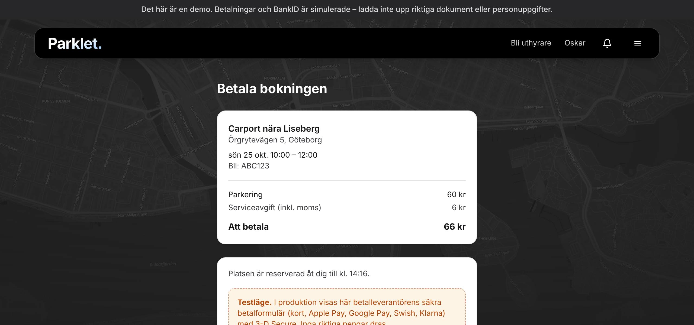
*Bild 4. Sammanställning före betalning, med hur länge platsen är reserverad.*

**5. Bekräftelsen.** Efter betalningen kommer föraren tillbaka till bokningen, fortfarande
inloggad, med instruktioner för att hitta och ta sig in, vägbeskrivning och till när avbokningen
är kostnadsfri. Länken **"Visa parkeringsplatsen och boka igen"** leder tillbaka till platsen. Ett
kvitto skickas med e-post.

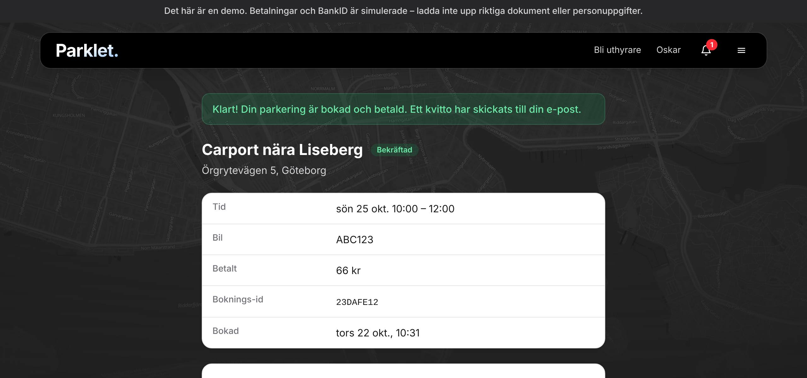
*Bild 5. Bokad och betald: länken tillbaka till parkeringsplatsen och bokningens uppgifter.*

**6. Mina sidor.** Överst under **Ditt konto** ser användaren sitt namn, sin e-postadress och
kontotyp (förare, eller förare och uthyrare med sina uthyrarkonton). Under kontot samlas kommande
och tidigare bokningar, som kan filtreras på datum och status, och sparade bilar finns under "Mina
fordon". Varje bokning visar när den gjordes. Användaren kan också ta bort kontot:
personuppgifterna tas bort, medan bokningarna sparas utan namn för bokföringen. Om platsen kräver
att bilen registreras hos föreningen ser föraren om det är gjort, och får besked om det inte är
klart när parkeringen börjar.

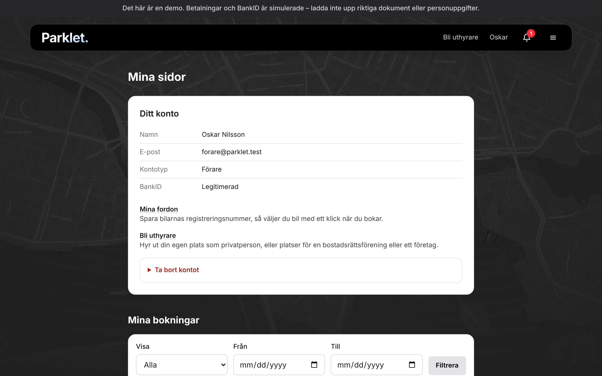
*Bild 6. Mina sidor: kontot överst, bokningarna under. Klockan i menyn visar nya notiser.*

**7. I mobilen.** Hela tjänsten fungerar i mobilen: sökresultaten ligger som ett ark över kartan och
platsens sida anpassar sig till skärmen.

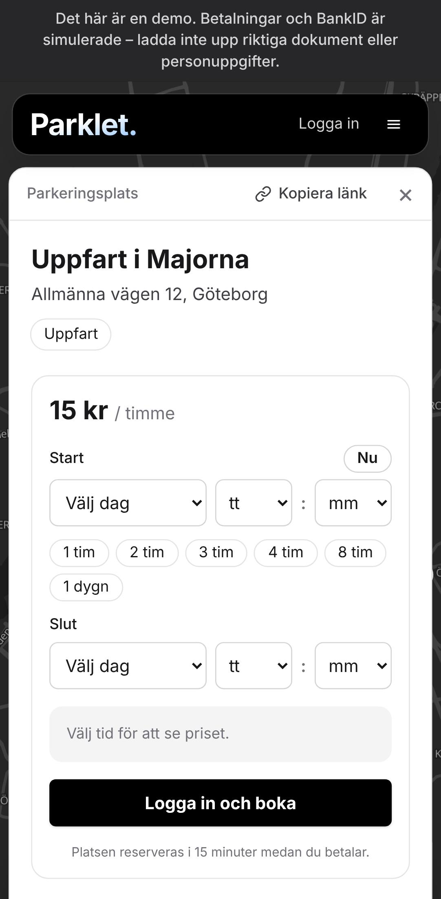

*Bild 7. En parkeringsplats i mobilen, med karta, pris och öppettider.*

### Uthyraren (privatperson, bostadsrättsförening eller företag)

**1. Bli uthyrare.** Uthyraren väljer om det är en privatperson, en bostadsrättsförening eller ett
företag. För föreningar och företag kontrolleras organisationsnumret mot Bolagsverket och det
registrerade namnet hämtas därifrån.

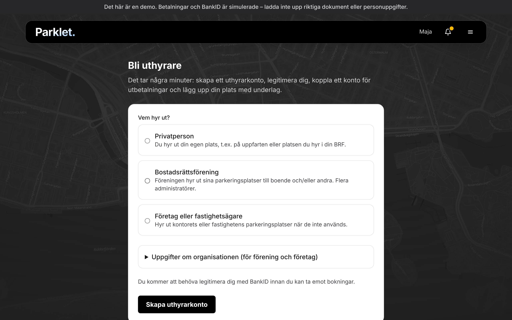
*Bild 8. Vem hyr ut? Tre sorters uthyrare, med var sitt flöde.*

**2. Checklistan.** Översikten leder genom stegen: legitimera sig med BankID, koppla
utbetalningskonto hos Stripe, lägga upp platsen med underlag och få den godkänd. Varje steg
förklarar vad som väntar och bockas av när det är klart.

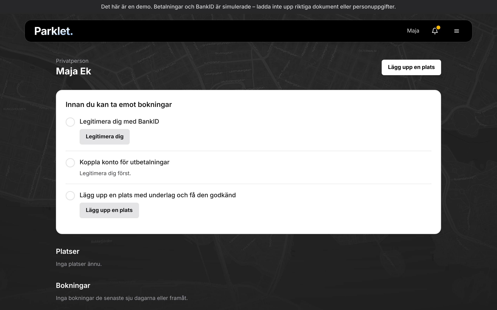
*Bild 9. En ny uthyrare: inget är klart än, och varje steg har sin knapp.*

**3. Lägg upp parkeringsplatsen.** Platsen läggs upp med adressökning och en nål som går att flytta
på kartan, typ och egenskaper, öppettider (färdiga mallar eller egna tider per veckodag, även över
midnatt), timpris med tak per dygn, kortaste bokning, framförhållning, avbokningsfönster,
instruktioner, och om platsen ska synas i sökningen eller bara via länk. Uthyraren anger också
sin **rätt att hyra ut** platsen: äger den, eller hyr den av en bostadsrättsförening eller en
hyresvärd.

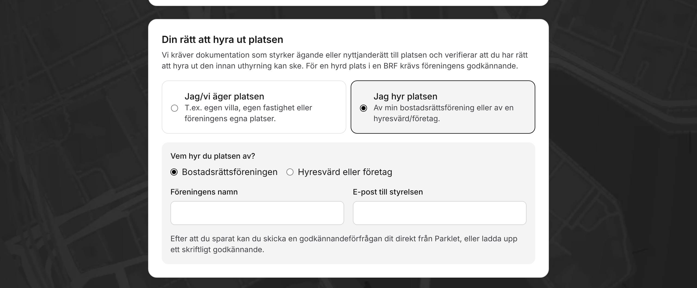
*Bild 10. Den som hyr sin plats anger av vem; föreningen tillfrågas i nästa steg.*

**4. Underlag och godkännande.** Platsen visar vilka underlag som krävs för just den rätten
(lagfart, hyresavtal, föreningens godkännande) och vad som saknas innan den kan skickas in.
Föreningens eller hyresvärdens godkännande kan begäras med en knapp, eller laddas upp som ett
skriftligt godkännande. En fil över 4 MB stoppas redan i webbläsaren, med ett besked om storleken.

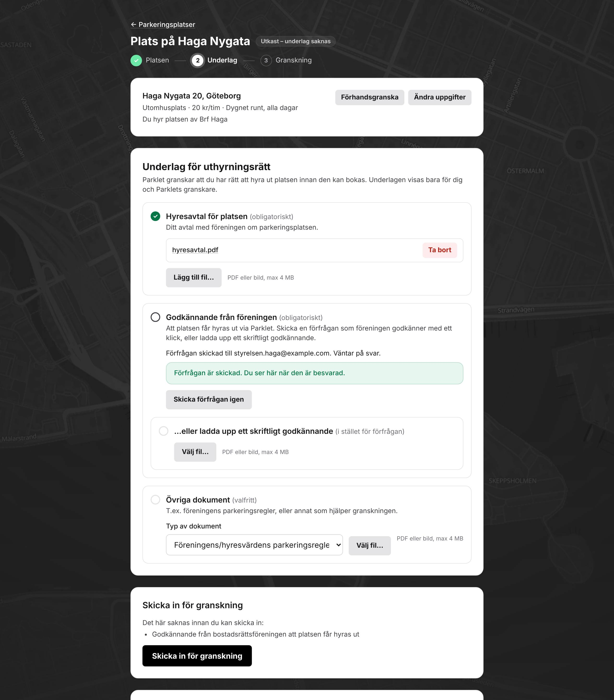
*Bild 11. Hyresavtalet är uppladdat och förfrågan till föreningen skickad; det som saknas står
längst ned.*

**5. Föreningen svarar.** Styrelsen får ett e-postmeddelande med en länk och svarar med ett klick,
utan att skapa konto. Den ser platsen och den BankID-legitimerade uthyraren, och kan ange att
tillfälliga hyresgästers bilar måste registreras hos föreningen. Har mottagaren redan ett
Parklet-konto syns förfrågan även i dennes notisklocka.

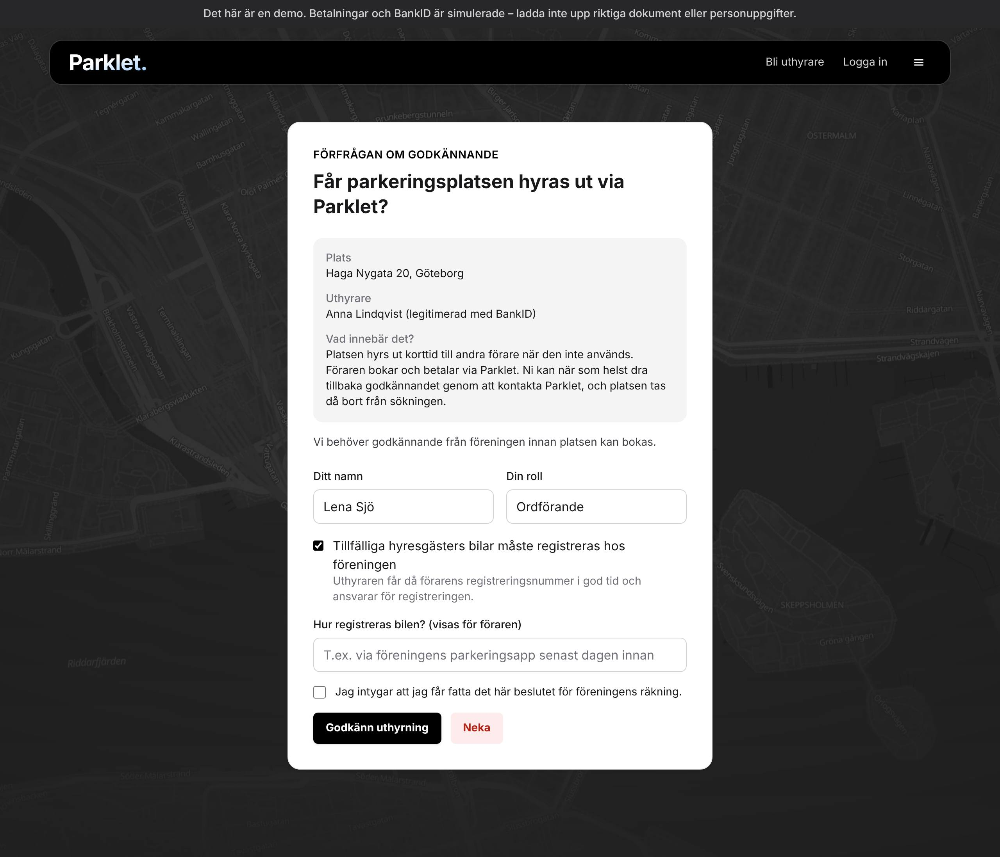
*Bild 12. Sidan styrelsen kommer till från e-postmeddelandet.*

**6. Uthyrarkontots flikar.** Varje uthyrarkonto har samma upplägg som Parklets egna
administrationssidor, med flikarna **Översikt**, **Granska**, **Parkeringsplatser**,
**Bokningar**, **E-post** och **Administratörer**. Översikten visar checklistan, utbetalningar och
tre rutor: vad som väntar på uthyraren, antalet parkeringsplatser och kommande bokningar med
intäkterna hittills.

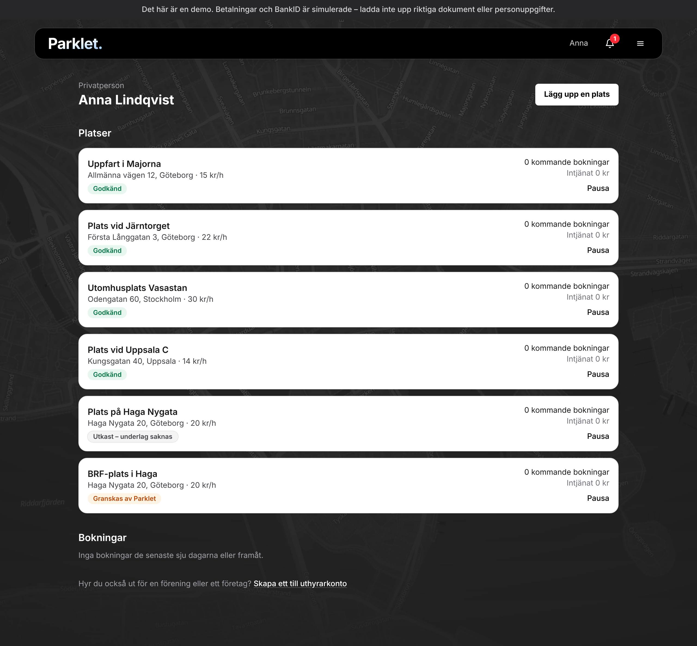
*Bild 13. Översikten för en privat uthyrare, med flikarna överst.*

**7. Parkeringsplatser, bokningar och e-post.** Flikarna är sökbara tabeller med filter, som
administratörens men begränsade till kontots egna uppgifter: parkeringsplatserna med
granskningsstatus och om de går att boka, bokningarna med förare, bil och betalning, och den
e-post tjänsten skickat om kontot. Föreningar och företag kan skapa "Plats 1–20" på en gång med
samma villkor och underlag.

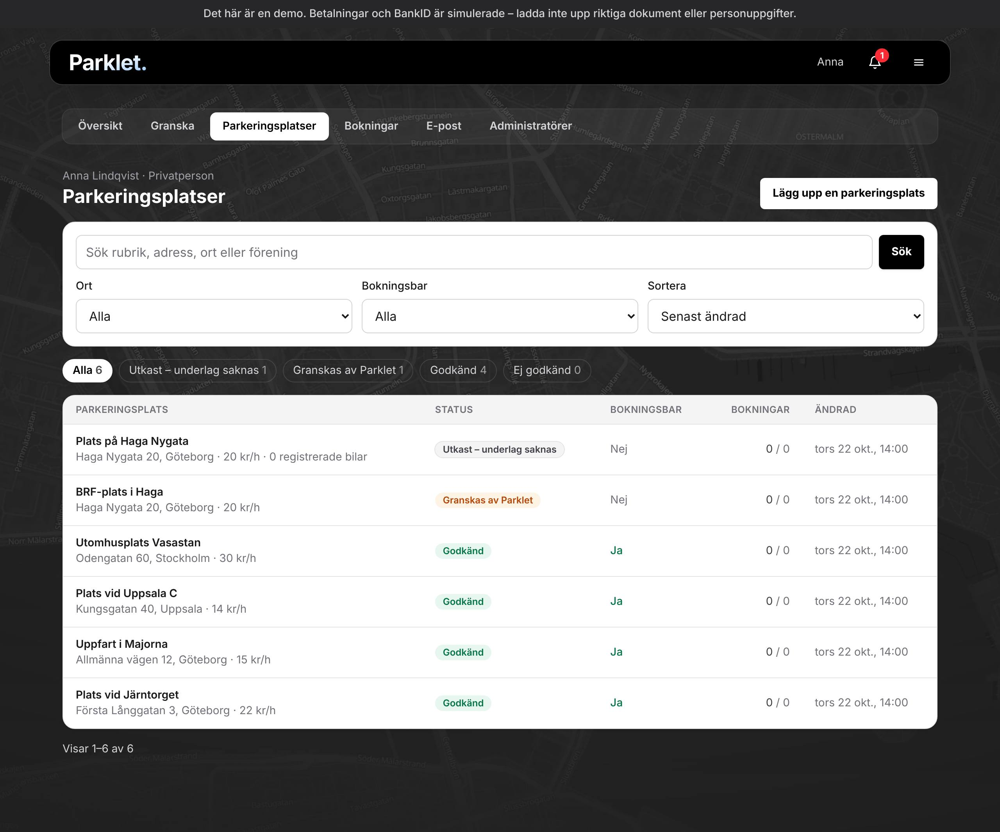
*Bild 14. Parkeringsplatserna i olika skeden: utkast, under granskning och godkända.*

**8. Granska och registrerade bilar.** Under **Granska** samlas det uthyraren behöver göra något
åt: parkeringsplatser att slutföra eller som väntar på föreningen eller på Parklet, och bilar att
registrera. Kräver föreningen att bilarna registreras får uthyraren förarens registreringsnummer,
grupperat per parkeringsplats, och bockar av när bilen är registrerad, med påminnelse före start
om det inte är gjort. En bil som bockats av sparas för platsen: nästa bokning med samma bil är
klar från början, och andra bokningar som väntar med samma bil blir klara direkt. På platsens
egen sida ser uthyraren de registrerade bilarna och kan lägga till och ta bort dem.

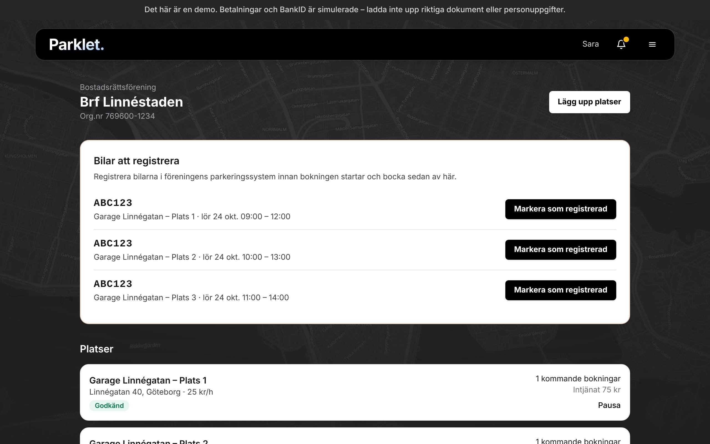
*Bild 15. Föreningens Granska-flik: bilar att registrera före kommande bokningar.*

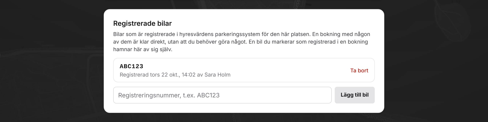
*Bild 16. En registrerad bil på parkeringsplatsens sida.*

**9. Administratörer och borttagning.** Under **Administratörer** bjuder kontots ägare in fler
administratörer via e-post, skickar en inbjudan igen, rättar adressen eller drar tillbaka den, tar
bort en administratör eller lämnar över ägandet; en administratör kan också lämna kontot själv.
En parkeringsplats eller ett helt uthyrarkonto kan tas bort i vilket skede som helst, även en
förening som fastnat i granskningen, så länge inga bokningar återstår. Det som redan har bokats
arkiveras i stället för att raderas, eftersom bokningarna sparas för bokföringen. Den som tar bort
sitt uthyrarkonto blir en vanlig förare igen.

**10. Notiser.** Uthyraren får besked via e-post och notisklockan när föreningen svarat, när en
plats godkänns, när någon bokar och om en bil behöver registreras. Klockan visar också det som
återstår att göra, och bara det uthyraren själv kan göra något åt.

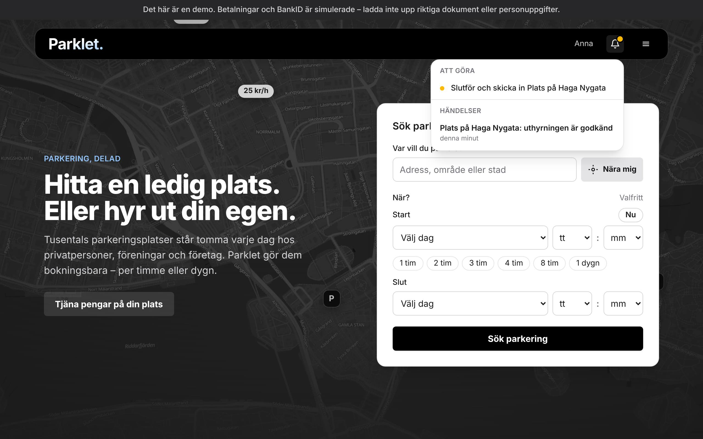
*Bild 17. Notisklockan: "Att göra" överst, händelser under.*

### Parklet själva (administratörer)

- **Granskningskö** för uthyrarkonton och parkeringsplatser, med dokumentvisare och Bolagsverkets
  svar. Varje beslut är *godkänn*, *avslå* (med en motivering som mejlas till uthyraren) eller
  *ta bort godkännandet*.

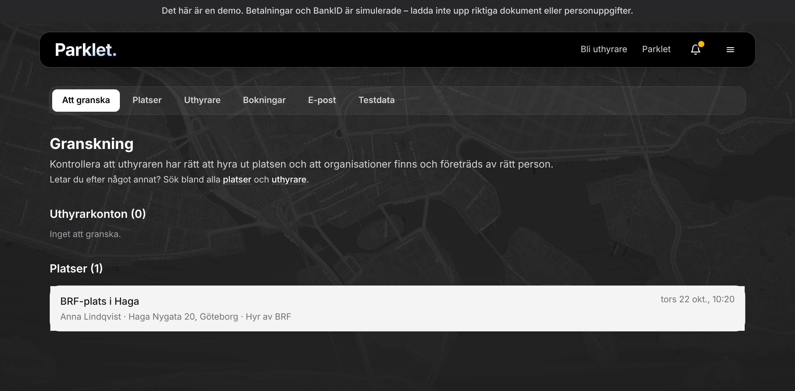
*Bild 18. Det som väntar på granskning.*

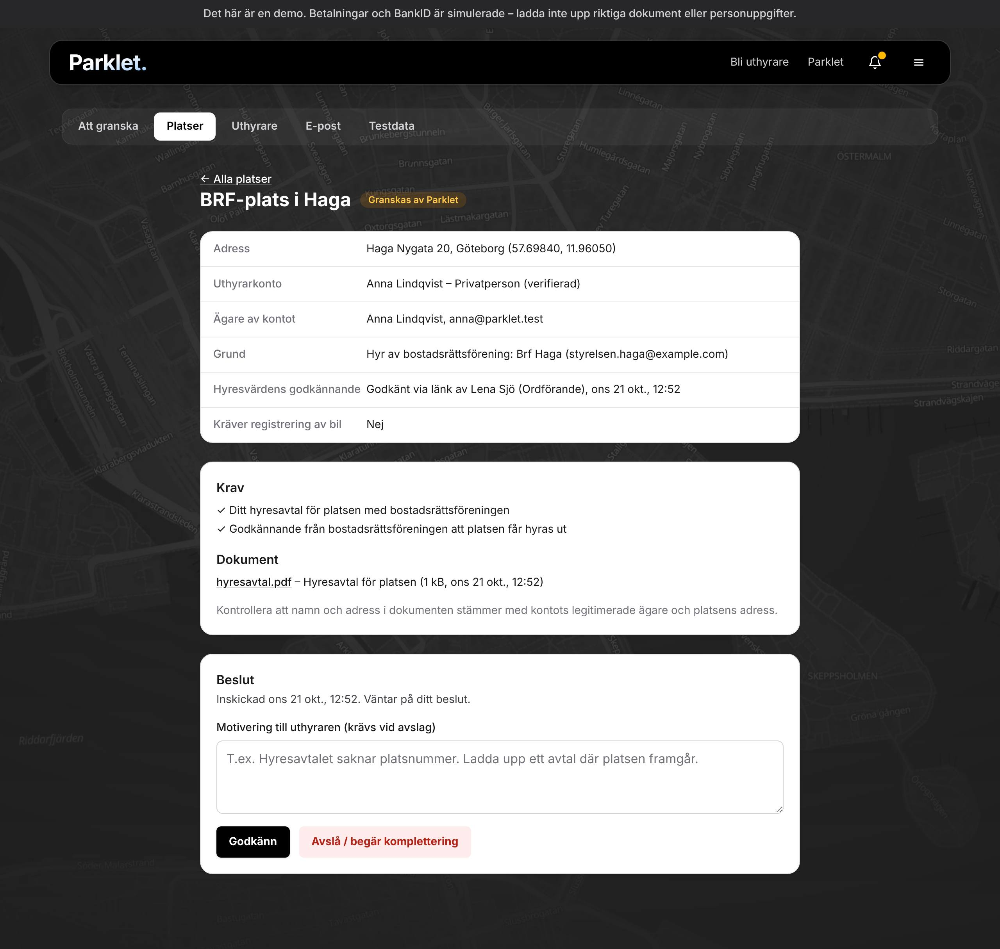
*Bild 19. En parkeringsplats under granskning: uppgifter, föreningens godkännande, krav, dokument
och beslut.*

- **Att ta bort ett godkännande får verkan direkt.** Tar man bort en plats godkännande försvinner
  den ur sökningen. Tar man bort ett kontos godkännande går kontots platser tillbaka till "ej
  godkänd" och måste godkännas på nytt; en förening eller ett företag skickar in sina underlag
  igen, och en privatperson legitimerar sig med BankID igen, vilket skickar kontot till Parklets
  granskning. Befintliga bokningar påverkas inte.
- **Sökning och filter** över alla parkeringsplatser, uthyrare och bokningar, med besked om
  *varför* en plats inte går att boka (till exempel "Utbetalning saknas"). Bokningarna kan sökas
  på plats, uthyrare, förare, e-post, registreringsnummer, boknings-id eller betalning, och
  filtreras på tid, period, betalning och ort.

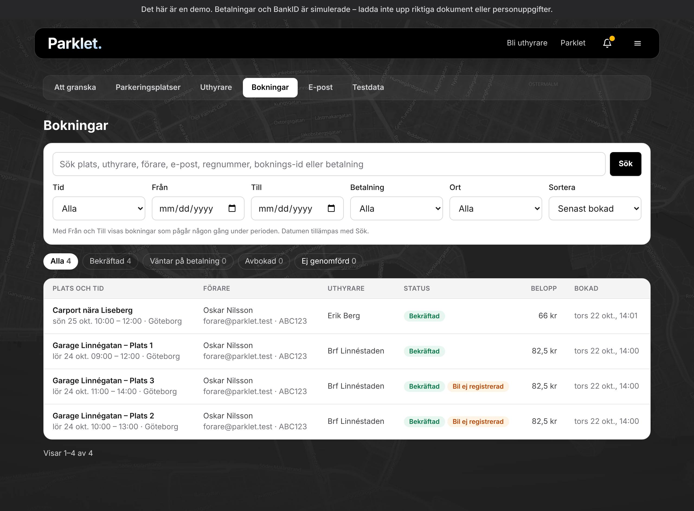
*Bild 20. Alla bokningar, med status och om bilen är registrerad.*

- **Notisklocka** med det som väntar ("Granska 3 platser"), och en **e-postlogg**: en sökbar
  tabell över all e-post tjänsten skickat, där varje meddelande går att läsa som det såg ut.

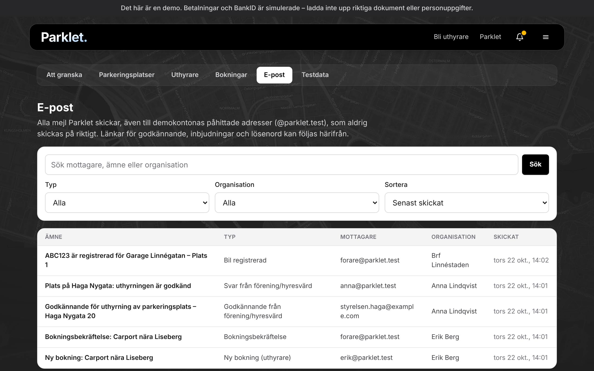
*Bild 21. E-postloggen med förfrågan till föreningen.*

- **Morgonsammanfattning** via e-post: vad som väntar på granskning och hur länge, samt det
  senaste dygnets bokningar, avbokningar, bilar som inte registrerats i tid och nya platser,
  uthyrare och användare. Den skickas bara när det finns något att berätta, och bara när den
  är påslagen under E-post, till en vald adress eller till alla administratörer.
- **Återställ testdata** (bara i demon): lägger tillbaka demokontona med deras platser, bokningar
  och dokument, så att ett test kan börja om från samma läge.

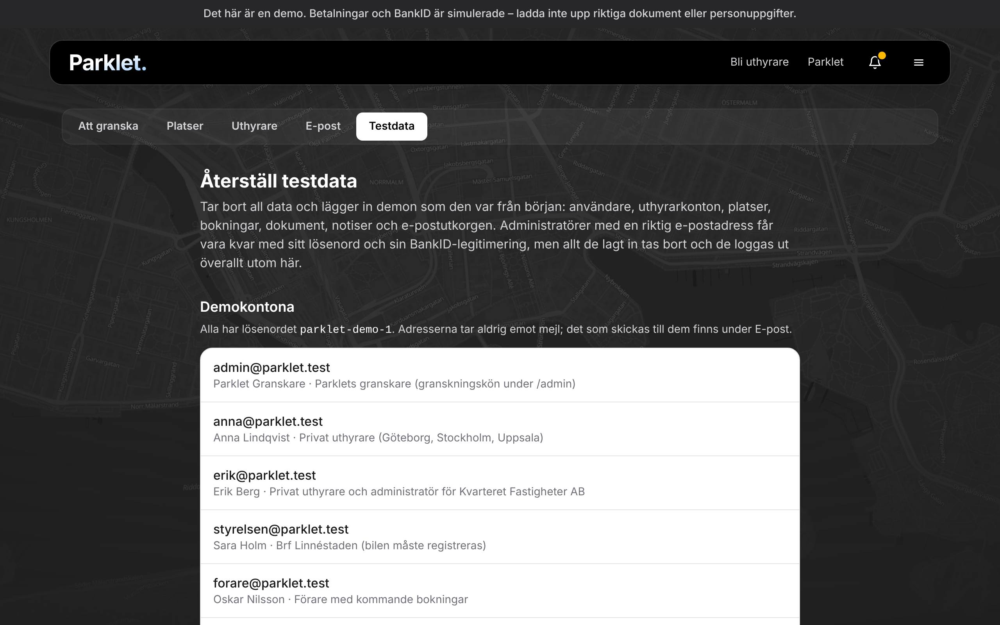
*Bild 22. Testdata-fliken med demokontona.*

Alla e-postmeddelanden och notiser finns listade i [04-emails.md](04-emails.md).

---

## 4. Teknisk översikt av den nya MVP:n

Dagens Parklet har inte sina problem för att ramverket är fel (den kör redan Next.js). De
beror på att affärsreglerna inte är modellerade, att det saknas tester och att juridiken inte
var med i designen. Den nya versionen är byggd så att de svåra delarna av en
parkeringsmarknadsplats blir rätt från grunden, och så att den är billig att driva för ett litet
team.

### 4.1 Arkitektur och tjänster

| Del | Val | Varför | Status |
|---|---|---|---|
| Webbapp | **Next.js 16** (App Router), **React 19**, **TypeScript**, **Tailwind CSS 4** | En kodbas för informationssidor, sökning, bokning, uthyrning och administration. Affärsregler och nycklar stannar på servern. Bra för sökmotorer | I drift |
| Drift | **Vercel**, region `arn1` (Stockholm), fastlåst i `vercel.json` | Beräkningen ligger bredvid databasen och inom EU | I drift |
| Databas | **PostgreSQL** hos **Supabase**, region `eu-north-1` (Stockholm) | Transaktioner och regler i databasen gör dubbelbokningar omöjliga (se 4.2) | I drift |
| Dataåtkomst | Supabases HTTP-gränssnitt (**PostgREST**) med servicenyckeln, bara från servern (`src/db/api.ts`). Steg som måste ske helt eller inte alls är Postgres-funktioner | Inga databasanslutningar från Vercels funktioner, alltså inga problem med anslutningspoolen (den fick sidor att hänga, se PR #8–#14) | I drift |
| Schema och migreringar | **Drizzle** (schema och typer) och drizzle-kit (SQL-migreringar i `src/db/migrations`) | Vanlig SQL med egna regler som exkluderingsvillkoret | I drift |
| Validering | **Zod** | Samma regler i formulär och på servern | I drift |
| Inloggning | E-post och lösenord; **BankID via Idura** (tidigare Criipto) för uthyrare | Svenskar förväntar sig BankID. Ger verifierat namn och personnummer för granskning och DAC7 | BankID i Iduras testmiljö |
| Betalningar | **Stripe Connect** | En licensierad partner håller pengarna, så Parklet behöver inget betaltjänsttillstånd (se 4.4) | I testläge tills vidare |
| Kartor | **MapLibre** med **OpenFreeMap**s kartdata, i Parklets egna färger | Ingen leverantörsinlåsning, ingen nyckel, kommersiell användning tillåten. MapTiler eller Stadia om man vill ha avtalad drifttid | I drift |
| Adressökning | **Photon** (OpenStreetMap), via Parklets egen server | Svenska adresser, begränsat till Sverige; servern kan cacha och begränsa anrop | Publik instans; ska bytas (se 4.9) |
| Dokument | Privat lagring i **Supabase Storage** (bucket `documents`) | Äganderättsbevis och hyresavtal är känsliga personuppgifter | I drift |
| E-post | **Resend** | Leveranssäkerhet; all e-post sparas dessutom i tjänsten | Kopplat; avsändardomän ska verifieras |
| Företagsregister | **Bolagsverkets** kostnadsfria API ("värdefulla datamängder") | Kontrollerar att organisationen finns och inte är avregistrerad | I drift |
| Schemalagda jobb | **pg_cron** i Supabase anropar appen | Påminnelser var tionde minut, morgonsammanfattning 06:00 UTC | I drift |
| Test och CI | **Vitest**, **Playwright**, **GitHub Actions** | Varje ändring kontrolleras innan den når användarna (se 4.7) | I drift |

Andra principer:

- **En app, svenska först.** En enda Next.js-app på en domän tar bort problemen med döda länkar
  och splittrat varumärke. Gränssnittet är på svenska (`lang="sv"`); texterna är samlade så att
  engelska kan läggas till senare.
- **Utbytbara leverantörer bakom små gränssnitt.** Betalningar (`src/server/payments.ts`),
  e-legitimation (`identity.ts`), e-post (`mailer.ts`), adressökning (`geocode.ts`) och
  dokumentlagring (`storage.ts`) är var sin liten modul. I utveckling används testversioner, så
  hela tjänsten kan provas utan avtal och nycklar; en skarp leverantör byter ut en fil.

**Det vi valt bort.**

- **No-code/low-code för kärnan.** Första versionen byggdes enligt pressen i Lovable. Det duger
  för att testa efterfrågan, men en marknadsplats med betalningar, verifiering och
  skatterapportering behöver kod som går att testa.
- **En separat sajt för marknadsföring** (Framer i dag). Den splittrar meny, sökmotorer och
  varumärke. Behövs ett redaktörsverktyg kan ett så kallat headless CMS (Sanity, Payload)
  visas i samma app.
- **En amerikansk region** för en svensk tjänst.
- **Att själva ta emot förarnas pengar** innan uthyraren får betalt (kräver tillstånd från
  Finansinspektionen, se 4.4).

**Driftkostnad vid lansering (uppskattning, kontrollera aktuella prislistor).**

| Tjänst | Ungefärlig kostnad |
|---|---|
| Vercel Pro | ca 20 USD/mån |
| Supabase Pro | ca 25 USD/mån |
| Resend | gratis i liten skala, ca 20 USD/mån därefter |
| Kartor (OpenFreeMap) | gratis; MapTiler ca 25–50 USD/mån om avtalad drifttid behövs |
| Felövervakning (Sentry) | gratisnivå räcker i början |
| Idura (BankID) | från ca 100 EUR/mån plus avgift per inloggning |
| Bolagsverkets API | gratis |
| Stripe | per transaktion: europeiska kort ca 1,5 % + 1,80 kr, plus avgift för Connect-utbetalningar |

Totalt **ungefär 2 000–3 000 kr i månaden** före transaktionsavgifter.

**Överlämning till Parklets egna konton.** Demon körs i dag på utvecklarens konton
(parklet-rebuild.vercel.app och Supabase-projektet `parklet`). Tjänsten är byggd för att flyttas:

- All konfiguration sker med miljövariabler, dokumenterade i `.env.example`. Inga nycklar,
  kontonamn eller kontospecifika adresser finns i koden.
- Regionen ligger i `vercel.json`, och databasen byggs upp från repot med migreringarna
  (`npm run db:migrate`). Demodata skapas med `npm run db:seed`.
- Alla leverantörer är vanliga konton som Parklet kan teckna i eget namn: Vercel, Supabase,
  Resend, Idura, Stripe och Bolagsverket. Den enda färdiga kopplingen mellan två leverantörer
  är Supabase-integrationen i Vercel, och den gör bara en sak: sätter databasens adress och
  nyckel som miljövariabler. Den kan kopplas om i Parklets konton eller ersättas genom att
  variablerna sätts för hand.
- Vid flytten skapas nya nycklar hos varje leverantör. **Undantaget är
  `IDENTITY_ENCRYPTION_KEY`**: flyttas befintliga uthyrare med, måste samma nyckel följa med,
  annars går de lagrade personnumren inte att läsa.
- Två saker ligger i dag bara i Supabase-projektet och måste återskapas för hand:
  pg_cron-jobben för påminnelser och morgonsammanfattning (`parklet-reminders`,
  `parklet-admin-digest`, se [04-emails.md](04-emails.md)) och jobbet som avslutar hängande
  databasfrågor (`scripts/supabase-stuck-queries.sql`). Det första bör läggas in som skript i
  repot.

### 4.2 Data och säkerhet

**Korrekthet i databasen.** Det värsta som kan hända en bokningstjänst är att två förare får
samma plats. Det stoppas av ett exkluderingsvillkor i Postgres, som gör överlappande bokningar
omöjliga oavsett hur många som bokar samtidigt:

```sql
ALTER TABLE bookings ADD CONSTRAINT bookings_no_overlap
  EXCLUDE USING gist (spot_id WITH =, tstzrange(starts_at, ends_at, '[)') WITH &&)
  WHERE (status IN ('pending_payment', 'confirmed'));
```

Appen kontrollerar också tillgängligheten först, för att kunna ge ett begripligt
felmeddelande, men samtidiga förfrågningar kan inte smita förbi villkoret. Ett test skickar fem
samtidiga bokningar och kontrollerar att exakt en lyckas.

**Pengar i heltal, tid i UTC, visning i svensk tid.** Priser lagras i hela ören, aldrig som
decimaltal. Tidpunkter lagras i UTC. Öppettider är svensk lokal tid och prövas dag för dag, så
bokningar över midnatt och vid omställning till sommar- och vintertid blir rätt; båda
omställningarna har egna tester.

**Dokument.** Typen avgörs av filens innehåll, inte av filnamnet (bara PDF, JPEG, PNG och HEIC,
högst 4 MB, eftersom Vercel begränsar storleken på inskickade data till 4,5 MB; en större fil
stoppas redan i webbläsaren, eftersom den annars aldrig når servern). Filerna ligger i
en privat bucket i Supabase Storage som bara servern når, och visas bara för medlemmar i det
uthyrarkonto som äger dem och för Parklets administratörer, med en säkerhetsinställning
(`Content-Security-Policy: sandbox`) som hindrar en uppladdad fil från att köra kod. Underlagen
är låsta medan Parklet granskar platsen och när den är godkänd.

**Personnummer.** Bara uthyrares personnummer lagras, och bara för att DAC7 kräver det (se 4.4);
förares personnummer behövs aldrig. Det hämtas från BankID, aldrig från en textruta, och
krypteras med AES-256-GCM innan det sparas, med nyckeln `IDENTITY_ENCRYPTION_KEY`. Saknas nyckeln
eller är den felaktig stängs BankID av hellre än att personnummer sparas okrypterat.

**Behörigheter.**

- Lösenord lagras som scrypt-hashar. Sessioner är slumpade nycklar som lagras som SHA-256-hashar;
  kakorna är `httpOnly`, `SameSite=Lax` och `Secure` i produktion.
- Varje serveråtgärd kontrollerar sessionen och medlemskapet på nytt; uthyrarsidor går genom
  `getAccountForMember`. Bara medlemmar i ett uthyrarkonto kan markera en bil som registrerad.
- Engångslänkar (lösenordsåterställning, godkännande från hyresvärd, inbjudningar) lagras som
  hashar och kan bara användas en gång.
- Inloggning och lösenordsåterställning är begränsade i antal försök. Återställningen avslöjar
  inte om en e-postadress finns.
- Säkerhetsrubriker på alla sidor, och servern talar inte om vilken programvara den kör.

**Radnivåsäkerhet (RLS).** Supabase gör databasen nåbar över internet med en publik nyckel.
Därför har varje tabell radnivåsäkerhet påslagen utan några regler som släpper in den publika
nyckeln: med den går ingenting att läsa. Parklets databasfunktioner kan bara köras med
servicenyckeln. Båda sakerna kontrolleras av tester (`tests/integration/row-level-security.test.ts`,
`api.test.ts`), och varje ny migrering måste följa samma mönster.

**Driftsäkerhet.** Varje anrop till databasen har en tidsgräns på 15 sekunder, och läsningar
görs om en gång vid nätverksfel. Ett pg_cron-jobb avslutar frågor som hängt i mer än två minuter
och meddelar administratörerna.

### 4.3 Reglerna marknadsplatsen upprätthåller

**Vad som gör en plats bokningsbar.** Sökning och bokning använder samma villkor: platsen är
aktiv, platsen är **godkänd** av Parklet, uthyrarkontot är **verifierat** och
**utbetalningskontot är kopplat**. Saknas något syns platsen inte, och administratören ser
varför.

**Uthyrningsrätt.** Kravet:

> Vi kräver dokumentation som styrker ägande eller nyttjanderätt till platsen och verifierar
> att uthyraren har rätt att hyra ut den innan uthyrning kan ske. För en hyrd plats i en BRF
> krävs föreningens godkännande.

Så följs det:

```
utkast ──skickas in──► granskas ──Parklet godkänner──► godkänd
  ▲                     │    ▲                            │
  └──tas tillbaka───────┘    │                            │
                Parklet │    │ skickas in igen            │ hyresvärden/BRF säger nej,
                avslår  │    │                            │ Parklet tar bort godkännandet
                        ▼    │                            │ eller kontot förlorar sitt godkännande
                     ej godkänd ◄─────────────────────────┘
```

En plats skickas bara in när underlagen är kompletta. Parklet kan också godkänna en plats som
tidigare avslagits.

- **Krav på underlag** (`spotRequirements` i `src/server/spots.ts`):
  - *Äger platsen*: bevis på ägande (fastighetsutdrag/lagfart, köpekontrakt eller
    upplåtelseavtal där platsen ingår).
  - *Hyr platsen*: hyresavtalet **och** hyresvärdens eller föreningens godkännande. Godkännandet
    kan lämnas på två sätt:
    1. **Godkännandelänk.** Parklet mejlar föreningen eller hyresvärden en länk
       (`/godkannande/[token]`). Mottagaren ser adressen och den BankID-verifierade uthyraren,
       och godkänner eller avslår med namn, roll och en försäkran om sin behörighet. Mottagaren
       kan samtidigt kräva att bilar registreras (se nedan). Har adressen ett Parklet-konto
       hamnar förfrågan också i den personens notisklocka.
    2. **Uppladdat skriftligt godkännande.**
- **Organisationer** (förening eller företag) verifieras också som sådana: ett giltigt
  organisationsnummer (med kontrollsiffra), som Bolagsverket bekräftar finns och inte är
  avregistrerat (det registrerade namnet används), ett registreringsbevis och styrelseprotokoll
  eller annat bevis på firmateckning. En administratör granskar innan kontot blir verifierat.
- **Privatpersoner** verifieras av BankID första gången. Har Parklet avslagit kontot eller tagit
  bort dess godkännande räcker inte en ny BankID-legitimering; den skickar kontot till Parklets
  granskning i stället.
- **Ändringar.** Ny adress, flyttad nål eller ny grund på en godkänd plats skickar den till
  granskning igen. Byter uthyraren hyresvärd blir platsen ett utkast som behöver ett nytt
  godkännande. Ett avslag från hyresvärden eller föreningen tar en godkänd plats ur sökningen
  direkt.
- **Ett konto som förlorar sitt godkännande börjar om.** Avslår eller återkallar en
  administratör ett konto går dess godkända och inskickade platser tillbaka till "ej godkänd" och
  måste godkännas var för sig igen. Befintliga bokningar står kvar.

Bra att veta för föreningar: att hyra ut många platser till icke-medlemmar kan påverka en
bostadsrättsförenings skattestatus som *privatbostadsföretag*. Uthyrarsidan säger det; det är
styrelsens bedömning tillsammans med revisorn.

**Registrering av bilar hos föreningen.** Kravet:

> Om föreningen kräver registreringsnummer behöver även den tillfälliga hyresgästens bil
> registreras.

- En plats kan markeras med **"Den tillfälliga hyresgästens bil måste registreras"**, av
  uthyraren eller av föreningen när den godkänner via länken. Markeringen kräver
  framförhållning: minst en timme, och minst ett dygn när föreningen har ställt kravet. Ett krav
  som föreningen ställt kan uthyraren inte ta bort så länge godkännandet gäller.
- Varje bokning är knuten till en bil (tabellen `vehicles` plus registreringsnumret sparat på
  bokningen). Bokningar på sådana platser börjar som "ej registrerad".
- Uthyrarens Granska-flik har listan **"Bilar att registrera"** med registreringsnummer, plats
  och tid, där uthyraren trycker *"Markera som registrerad"*. Föraren ser status på sin bokning.
- **En registrerad bil gäller för platsen** (tabellen `spot_vehicle_approvals`,
  `src/server/vehicle-approvals.ts`). När en bil markeras som registrerad sparas den för platsen,
  och andra bokningar på platsen som väntar med samma bil blir klara direkt, med besked till
  förarna. En ny bokning med en registrerad bil är klar från början, och bokningsformuläret säger
  det. Uthyraren kan lägga till och ta bort bilar på platsens sida; en borttagen bil påverkar inte
  bokningar som redan är klara.
- Två timmar före start påminns uthyraren. Har bilen inte registrerats när parkeringen börjar får
  föraren beskedet "vänta med att parkera", uthyraren en varning och administratörerna en notis.

**Borttagning** (`src/server/host-deletion.ts`). Uthyraren kan ta bort en parkeringsplats eller
ett helt uthyrarkonto i vilket skede som helst, men inte medan bokningar återstår. Det som aldrig
bokats raderas. Det som har bokningar arkiveras (`deleted_at`): pausat, utan medlemmar, dokument
och registrerade bilar, och borta ur alla listor, medan bokningarna står kvar för bokföringen. När
en användare tar bort sitt konto går uthyrarkonton som användaren äger samma väg.

**Bokningsregler i övrigt.** En bokning håller platsen i 15 minuter medan föraren betalar
(hållningen omfattas av exkluderingsvillkoret). En bokning får vara högst 30 dygn och kan göras
upp till två månader fram. Uthyraren väljer kortaste bokningstid, framförhållning och
avbokningsfönster (0, 1, 2, 24 eller 48 timmar). Föraren betalar uthyrarens pris plus Parklets
serviceavgift, 10 % och minst 5 kr, redovisad separat.

### 4.4 Betalningar och regelverk

**Det juridiska problemet.** Tar Parklet emot förarens pengar på ett eget konto och betalar
uthyraren senare är det en betaltjänst åt tredje part. Det kräver tillstånd från
Finansinspektionen enligt lagen om betaltjänster, eller ett snävt undantag. Att hålla pengar
medför också skyldigheter enligt penningtvättslagen att kontrollera uthyrarna.

**Lösningen.** En licensierad betalpartner håller pengarna: **Stripe Connect**, i testläge tills
vidare (alternativ: Adyen for Platforms, Mangopay). Stripe sköter identitets-, bankkonto- och
penningtvättskontroller av uthyrare, stark kundautentisering (3-D Secure), kort, Apple Pay,
Google Pay, Klarna och Swish, återbetalningar och utbetalningar.

| Steg | Så fungerar det |
|---|---|
| Uthyrare ansluter | Kontots ägare klickar **Koppla utbetalningskonto** och fyller i Stripes egen registrering (ett anslutet Express-konto, förifyllt med namn, e-post och organisationsnummer). Stripe kontrollerar identitet och bankkonto. Platserna kan bokas först när Stripe har godkänt kontot (`charges_enabled` och `payouts_enabled`); dessförinnan visar översikten om Stripe granskar eller behöver fler uppgifter, med en knapp tillbaka till Stripe |
| Bokning | En bokning med status "väntar på betalning" håller platsen i 15 minuter |
| Betalning | Föraren betalar på Stripes betalsida (Stripe Checkout, på svenska, i kronor) med de betalsätt som är påslagna hos Stripe: kort, Apple Pay, Google Pay, Klarna m.fl. Parklet ser aldrig kortuppgifterna. När betalsidan öppnas förlängs reservationen till betalsidans livslängd (31 minuter, Stripes minimum är 30), så platsen är reserverad så länge betalningen kan genomföras |
| Pengarna | En betalning på plattformen (*destination charge*): uthyraren får parkeringspriset (`transfer_data.destination`), Parklet behåller serviceavgiften (`application_fee_amount`) och betalar Stripes avgift ur den |
| Bekräftelse | Föraren skickas tillbaka till den adress betalningen startades från (`src/server/request-origin.ts`), så att inloggningen gäller även på en förhandsversion eller annan adress till tjänsten. När föraren kommer tillbaka från Stripe hämtar servern betalningens status direkt från Stripe, och Stripes signerade händelser (`checkout.session.completed` m.fl.) bekräftar också. Det som kommer först gäller; båda tål att komma flera gånger. Webbläsarens egna uppgifter litas aldrig på |
| Avbruten eller sen betalning | Betalas inget släpps platsen när betalsidan går ut. Kommer en betalning ändå för sent behålls bokningen bara om platsen fortfarande är ledig (databasen gör dubbelbokningar omöjliga); annars betalas pengarna tillbaka automatiskt och föraren meddelas |
| Avbokning | Återbetalning via Stripe enligt avbokningsreglerna, som även återför överföringen till uthyraren och Parklets avgift. En återbetalning som görs direkt i Stripes kontrollpanel avbokar bokningen |
| Utbetalning | I dag förs pengarna över till uthyrarens Stripe-konto vid betalningen och betalas ut enligt Stripes vanliga schema. Villkoren säger att uthyraren får betalt efter bokningen; före lansering behöver det beslutas (fördröjd utbetalning, eller separata överföringar efter bokningens slut) |

**Öppna frågor om betalningarna.** Parklet är säljare (*merchant of record*) på varje
betalning, vilket påverkar moms, kvitton och integritetspolicyn (som ska nämna Stripe som
personuppgiftsbiträde); stäm av med redovisningskonsult och jurist. Vid en avbokning förlorar
Parklet Stripes transaktionsavgift, och om uthyraren redan fått sina pengar utbetalda kan en
återföring göra uthyrarens saldo negativt; den förlusten bär Parklet. Bostadsrättsföreningar
registreras hos Stripe som ideell organisation (`non_profit`), vilket bör bekräftas med en
riktig förening.

**Andra skyldigheter som följer med.**

- **DAC7.** Plattformar ska samla in identitetsuppgifter (bland annat personnummer eller
  skatteregistreringsnummer och adress) för uthyrare och rapportera deras inkomster till
  **Skatteverket** varje år (senast 31 januari). Uthyrning av parkering räknas som uthyrning av
  fast egendom. Därför måste uthyrares personnummer lagras, krypterat och med begränsad åtkomst
  (se 4.2). Insamlingen via BankID finns; den årliga exporten återstår.
- **Moms.** Parklets serviceavgift är momspliktig (25 %). Uthyrare som är företag (och vissa
  föreningar) kan själva behöva ta ut moms på parkeringen. Kvitton ska visa säljare, moms och
  Parklets avgift var för sig. Stäm av med en redovisningskonsult.
- **Bokföring.** Transaktioner ska sparas i sju år enligt bokföringslagen.
- **Konsumenträtt.** En bokning hos ett företag är ett konsumentköp; en bokning hos en
  privatperson är det inte. Om ångerrätten gäller tidsbestämd parkering är en fråga för jurist;
  villkorssidan markerar frågan.

### 4.5 Integrationer och status

| Integration | Vad den gör | Status i dag | Kvar före lansering |
|---|---|---|---|
| **BankID via Idura** | Inloggning med OpenID Connect; ger verifierat namn och personnummer (`IDURA_*`, `IDENTITY_ENCRYPTION_KEY`) | Fungerar mot Iduras testmiljö; utan inställningar används en testversion som godkänner direkt | Idura-abonnemang och produktionscertifikat |
| **Bolagsverket** | Slår upp organisationsnummer: finns det, registrerat namn, juridisk form, avregistrerad eller under avveckling (`BOLAGSVERKET_*`) | I drift. Utan inloggningsuppgifter hoppas kontrollen över och bara den manuella granskningen gäller | Bolagsverkets betal-API kan dessutom bekräfta att den BankID-verifierade personen får teckna organisationen, vilket i de flesta fall gör dokumentgranskningen onödig |
| **Stripe Connect** | Betalningar och utbetalningar (se 4.4): Stripe Checkout, Express-konton för uthyrare, signerade händelser till `/api/stripe/webhook` (`PAYMENT_PROVIDER=stripe`, `STRIPE_SECRET_KEY`, `STRIPE_WEBHOOK_SECRET`) | Byggt och testat mot en simulerad Stripe; körs i testläge när nycklarna är inlagda. Utan dem används en testversion som godkänner direkt | Skarpt läge, aktivering av plattformskontot hos Stripe, beslut om utbetalningstidpunkt |
| **Resend** | Skickar e-post. All e-post sparas även i tabellen `mail_outbox` och kan läsas av administratörer på `/admin/epost`; demoadresser (`@parklet.test`) skickas aldrig | Kopplat | Verifierad avsändardomän (parklet.se) |
| **Kartor** | MapLibre med OpenFreeMaps vektorkartor; MapLibre levereras från Parklets egen server | I drift | Inget krav; MapTiler/Stadia om avtalad drifttid önskas |
| **Adressökning** | Photon (OpenStreetMap) via Parklets server (`/api/geocode`), begränsat till Sverige. Ligger tjänsten nere returneras inga förslag i stället för ett fel | Använder den publika instansen photon.komoot.io | Egen Photon-instans eller kommersiell tjänst (Mapbox Search, Lantmäteriet) |
| **Dokumentlagring** | Privat bucket i Supabase Storage (`DOCUMENT_STORAGE=supabase`) | I drift | — |
| **Schemalagda jobb** | pg_cron och pg_net i Supabase anropar `/api/cron/paminnelser` var tionde minut och `/api/cron/sammanfattning` 06:00 UTC, med en nyckel som skapats i databasen | I drift | Återskapas vid flytt (se 4.1) |

### 4.6 Kodens upplägg

```
src/
  app/                 Sidor och serveråtgärder
    (auth)/            Inloggning, registrering, lösenordsåterställning
    sok/               Sökning: kartan med platsen och bokningen i en sidopanel
    betala/ bokning/   Betalning (testläge) och bokningsdetaljer
    uthyrare/          Uthyrarkontots flikar (översikt, granska, parkeringsplatser, bokningar,
                       e-post, administratörer), platsformulär, underlag
    godkannande/       Godkännandelänken för hyresvärd/BRF
    admin/             Granskning, sökning, bokningar, e-postlogg, testdata
    api/               Adressökning, dokumentnedladdning, hälsokontroll, schemalagda jobb
  components/          Gränssnitt (formulär, kartor, uthyrarvyer)
  db/                  Drizzle-schema, SQL-migreringar, HTTP-lagret mot Supabase
  lib/                 Ren logik för både webbläsare och server: pris, tillgänglighet, tid, validering
  server/              Dataåtkomst och integrationer (bara server)
```

Fyra lärdomar om Next.js 16 och React 19 som påverkar fortsatt utveckling:

- Med Cache Components ligger föregående sida kvar (dold) när man navigerar. Fält-id:n i
  formulär måste därför vara unika per instans (`useFieldIds`), och tillstånd i webbläsaren
  överlever navigering, så bokningsformuläret är knutet till vem som tittar.
- React nollställer ett formulär när dess serveråtgärd körts. Formulären (`FormAlert` i
  `src/components/form.tsx`) hindrar det när något gick fel, flyttar fokus till första felaktiga
  fält och upprepar felet vid skicka-knappen i långa formulär. Så behåller användaren det den
  fyllt i.
- React återanvänder samma element när en vy byts mot en annan på samma plats. En knapp som
  växlar till ett formulär kan då bli formulärets skicka-knapp och skicka det med samma klick.
  Vyer som byts ut får därför var sin `key`, och växlingsknappar anropar `preventDefault()`.
- Ett `datetime-local`-fält med `step=900` räknar steg från `min`, så `min` måste ligga på en
  kvart, annars blockerar webbläsaren tyst inskickningen.

### 4.7 Tester

| Nivå | Verktyg | Vad som täcks |
|---|---|---|
| Enhetstester (`tests/unit`) | Vitest | Prisberäkning, tillgänglighet, sommar- och vintertid, scheman, kryptering, Bolagsverkets svar, e-postmallar, filtyper |
| Integrationstester (`tests/integration`) | Vitest mot en riktig Postgres via PostgREST | Hållningar och samtidiga bokningar, synlighet i sökningen och sökfilter, avbokning, bilregistrering och registrerade bilar per plats, borttagning av platser och uthyrarkonton, påminnelser, morgonsammanfattning, hyresvärdens godkännande, granskning och borttagna godkännanden, betalningar och utbetalningar via Stripe (signerade händelser, dubbletter, utgångna och sena betalningar, återbetalningar, avgifter), återställning av testdata, behörigheter, radnivåsäkerhet |
| End-to-end (`e2e/`) | Playwright mot ett produktionsbygge, dator och mobil | Förarens bokning, dubbelbokning, uthyrare med BRF-godkännande, verifiering av organisationer och inbjudningar, uthyrarkontots flikar och administratörer, borttagning, sidhuvudet efter in- och utloggning, kontroll av filtyp och filstorlek vid uppladdning, granskning och borttagna godkännanden, behörigheter, formulär som behåller sitt innehåll, betalning och utbetalningskonto via Stripe, genomgång av alla länkar. BankID, Bolagsverket och Stripe ersätts av lokala testtjänster (`e2e/fake-idp.mjs`, `e2e/fake-bolagsverket.mjs`, `e2e/fake-stripe.mjs`), så att den riktiga koden för kopplingarna körs |
| Live-tester (`tests/live`) | Vitest mot riktiga tjänster | Bolagsverkets API och Stripes testläge. Körs varje måndag i GitHub Actions ("Live integrations") med uppgifter från repots hemligheter, och hoppas över utan dem |

GitHub Actions kör vid varje ändring lint, typkontroll, enhets- och integrationstester, bygge och
end-to-end-tester. En manuell testplan för huvudflödena finns i [05-testplan.md](05-testplan.md).

### 4.8 Medvetet utanför MVP:n

Föreslagen ordning efter lansering:

1. **Bilder på platser** (uppladdning av uthyraren, moderering).
2. **Manuellt godkännande av bokningar** (uthyraren accepterar förfrågningar) och
   **meddelanden** mellan förare och uthyrare.
3. **Grupper och medlemspriser** för föreningar (boende får internpris eller förtur) och
   kölistor. Dagens Parklet har detta i sitt flöde.
4. **Återkommande bokningar och månadsbokningar**, med vecko- och månadspriser.
5. **Omdömen** och ett flöde för tvister ("platsen var upptagen").
6. **Integration med parkeringsbolag** som föreningar använder (Aimo, EasyPark, Parkster eller
   föreningens egen app), så att bilregistreringen sker automatiskt, och eventuellt uppslag i
   Transportstyrelsens fordonsregister (betaltjänst) för att fånga felskrivna
   registreringsnummer.
7. **Bolagsverkets betal-API** för firmateckning (se 4.5).
8. **Kartsökning med PostGIS**, samlade nålar för många platser på samma adress och
   **stadssidor** för sökmotorer.
9. **Engelskt gränssnitt** (`next-intl`) och ett appskal (först som PWA).
10. **Besöksstatistik** utan kakor eller med EU-lagring (Plausible eller PostHog EU).

### 4.9 Nästa steg före lansering

**Måste vara klart.**

1. **Betalningar i skarpt läge.** Stripe Connect går från testläge till skarpt läge: aktiverat
   plattformskonto, signerade händelser från Stripe i produktion, beslut om när uthyrare får
   betalt och kvitton med moms och Parklets avgift var för sig (se de öppna frågorna i 4.4).
2. **BankID i produktion.** Idura-abonnemang och produktionscertifikat.
3. **E-post från parklet.se.** Verifierad avsändardomän i Resend (`MAIL_FROM`).
4. **Juridik.** Jurist granskar användarvillkor och integritetspolicy (i dag utkast), frågan om
   ångerrätt och företagsuppgifterna på sajten. Personuppgiftsbiträdesavtal med leverantörerna.
5. **Skatt och redovisning.** Insamling av DAC7-uppgifter och den årliga exporten till
   Skatteverket, moms på serviceavgiften och rutin för att spara transaktioner i sju år; stäm av
   med redovisningskonsult.
6. **Flytt till Parklets egna konton** (Vercel, Supabase, Resend, Idura, Stripe, Bolagsverket) och
   domänen parklet.se, med nya nycklar och de schemalagda jobben återskapade (se 4.1).
7. **Felövervakning.** Sentry (med EU-lagring) eller motsvarande, så att fel av den typ som
   hittades i granskningen (tysta avvisade anrop, halvt utritade kartor) upptäcks direkt. Det
   finns inte i dag.
8. **Begränsning av inloggningsförsök över flera servrar.** I dag räknas försöken per
   serverinstans; Vercel kör flera instanser, så räknaren bör flyttas till en delad lagring
   (Redis/Upstash).
9. **Adressökning** på egen eller kommersiell tjänst i stället för den publika Photon-instansen.
10. **Ta bort demoläget**: demokonton, demodata och testlägesbanderoller (`NEXT_PUBLIC_DEMO`).

**Affären.** Utbudet avgör om tjänsten fungerar. Välj en stad att starta i, och värva
föreningar och fastighetsägare där innan förarna bjuds in, så att den första sökningen ger
träffar.
