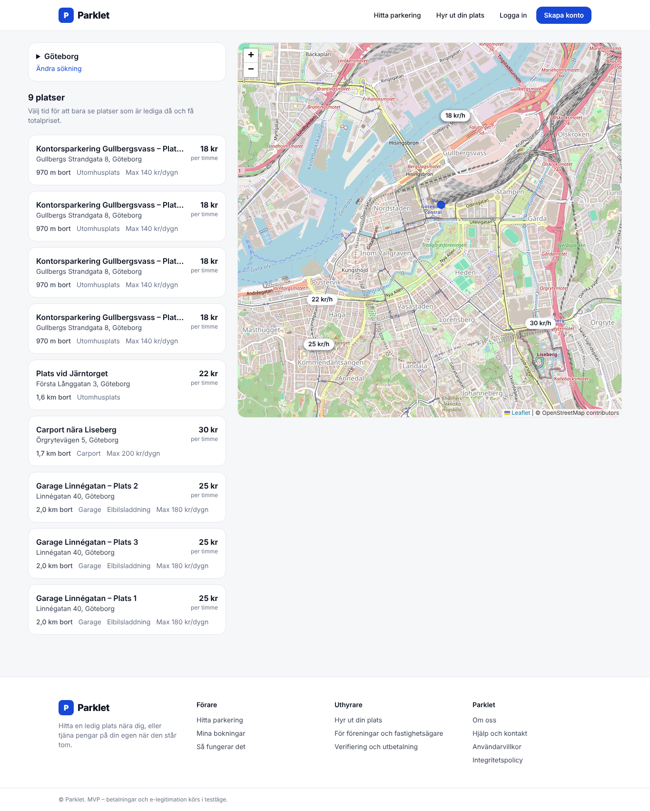
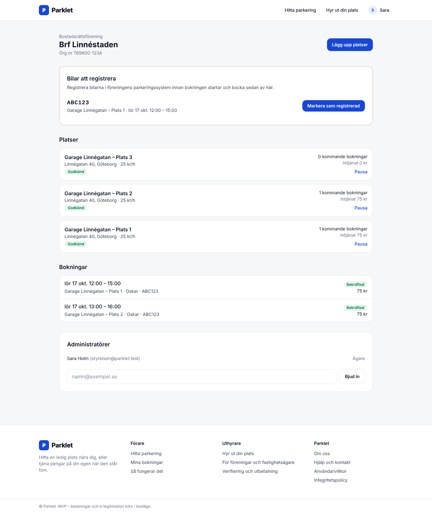

# The MVP: what it does, how it's built, what's left



## What works end to end

**Drivers**
- Search by address, city or "Nära mig", with optional from/to. With a time range, only spots
  free for the *whole* period are shown, with the total price. If nothing is within 3 km,
  search widens to 15 km and says so.
- Listing page: map, features, a human-readable schedule ("mån–fre 07:00–18:00"), busy times,
  cancellation terms, host verification badge.
- Booking: live price preview using the same code as the server, saved vehicles or a new plate,
  a 15-minute hold, checkout, confirmation with access instructions and directions.
- "Mina bokningar", "Mina fordon", free cancellation inside the spot's window.

**Hosts** (private person, BRF or company)
- Host account → BankID (mock) → payout account (mock Stripe Connect) → spot → documents → review.
- Spot form: address search plus a draggable pin, type and features, schedule presets or
  custom per-weekday hours (overnight supported), hourly price with a daily cap, minimum length,
  notice period, cancellation window, access instructions, public or link-only visibility.
- Right-to-rent section with the policy text and a basis: *owns* or *rents*, and if rents,
  *from a BRF* or *from a landlord*.
- Organisations: create "Plats 1…N" in one go, share documents and submission across them,
  invite administrators by email.
- Dashboard: setup checklist, spots with review status and earnings, bookings, and a
  **"Bilar att registrera"** to-do list.

**Parklet admins**
- Review queue for organisations and spots, document viewer, approve or reject with a reason
  (which is emailed to the host).



## The three hard requirements

### 1. Right to rent out ("uthyrningsrätt")

> Vi kräver dokumentation som styrker ägande eller nyttjanderätt till platsen och verifierar
> att uthyraren har rätt att hyra ut den innan uthyrning kan ske. För en hyrd plats i en BRF
> krävs föreningens godkännande.

How the MVP enforces it:

```
draft ──(required documents present)──► pending_review ──(admin)──► approved
  ▲                                           │                         │
  └───────────── rejected ◄───────────────────┘                         │
                    ▲   address or basis changes → pending_review again │
                    └──────── BRF/landlord withdraws/declines ◄─────────┘
```

- **Required documents** (`spotRequirements` in `src/server/spots.ts`):
  - *Owns*: proof of ownership (lagfart/fastighetsutdrag, purchase contract, or an
    upplåtelseavtal that includes the spot).
  - *Rents*: the rental contract **and** the landlord's or BRF's approval. Approval can come
    two ways:
    1. **Approval link.** Parklet emails the board (`/godkannande/[token]`). A board member
       sees the address and the BankID-verified host, then approves or declines with their
       name, role and an authority declaration. They can also require vehicle registration
       (see #3). The token is single-use and stored hashed.
    2. **Uploaded written approval** (`sublet_permission`).
- **Organisations** (BRF/company) also verify the organisation itself: a valid org.nr
  (Luhn-checked), a registration certificate, and board minutes or proof of signatory
  authority. An admin reviews these before the account is "verified".
- **Nothing is bookable until everything holds.** Search and booking share one SQL condition
  (`bookableSql`): the spot is active, the spot is approved, the account is verified, and
  payouts are connected.
- **Changing the address, pin or basis** of an approved spot sends it back to review. A
  declined BRF approval pulls an approved spot immediately.
- **Documents are private.** Their type is sniffed from the bytes (PDF/JPEG/PNG/HEIC only,
  10 MB). They're stored outside the web root and served only to account members and admins,
  with `Content-Security-Policy: sandbox`.

Worth knowing for associations: renting many spots to non-members can affect a BRF's tax
status as a *privatbostadsföretag*. The host page says so; it's the board's call with their
auditor.

### 2. Compliant payments

**The legal problem.** If Parklet takes a driver's money into its own account and later pays
the host, it is providing a payment service to third parties. That needs Finansinspektionen
authorisation (lagen om betaltjänster) or a narrow exemption. Holding funds also brings AML
obligations (penningtvättslagen) for checking hosts.

**The design.** Let a licensed payment partner be the one holding the money: **Stripe Connect**
(alternatives: Adyen for Platforms, Mangopay).

| Step | Production (Stripe) | MVP (mock) |
|---|---|---|
| Host onboarding | Express connected account; Stripe does identity, bank account and AML checks; payouts only when `charges_enabled`/`payouts_enabled` | "Koppla utbetalningskonto (testläge)" sets `payout_status = active` |
| Booking | A `pending_payment` row holds the slot for 15 min (the exclusion constraint covers holds) | Same |
| Checkout | PaymentIntent on the platform with `application_fee_amount` = service fee and `transfer_data.destination` = host account; Payment Element or Checkout with SCA/3-D Secure; cards, Apple/Google Pay, Klarna, Swish | `/betala/[id]` with a "Betala (testläge)" button |
| Confirmation | **Only** from the `payment_intent.succeeded` webhook (signature-verified, idempotent), never from the browser redirect | `confirmPayment()` is the same function the webhook would call. It's idempotent and refuses expired holds |
| Cancellation | Refund through Stripe, which reverses the transfer and application fee | Status `refunded` |
| Payout timing | Delay payouts until the booking ends (`separate charges and transfers` or a payout schedule), to absorb disputes | Earnings shown on the dashboard |

**Other obligations that come with the territory**
- **DAC7.** Platforms must collect identity details (including personnummer/TIN and address)
  for hosts and report their income to **Skatteverket** every year (deadline 31 January).
  Renting out parking counts as renting out immovable property. So hosts' personnummer has
  to be stored after all: encrypted, access-restricted, taken from BankID rather than typed.
  Drivers' personnummer is never needed.
- **VAT.** Parklet's service fee is subject to 25% Swedish VAT. Hosts that are businesses
  (companies, some associations) may themselves have to charge VAT on parking. Receipts
  must show seller, VAT and Parklet's fee separately. Confirm with an accountant.
- **Bookkeeping.** Keep transaction records for 7 years (bokföringslagen).
- **Consumer law.** Driver ↔ company host bookings are consumer purchases. Driver ↔ private
  host bookings are not. Whether the right of withdrawal applies to time-bound parking is a
  question for a lawyer; the terms page marks it.

### 3. Vehicle registration with the association

> Om föreningen kräver registreringsnummer behöver även den tillfälliga hyresgästens bil
> registreras.

- A spot can be flagged **"Den tillfälliga hyresgästens bil måste registreras"** by the host,
  or by the BRF when it approves via the link. The flag requires **notice**: at least 1 hour,
  defaulting to 1 day when the BRF sets it, so there is time to register the car.
- Every booking is tied to a vehicle (`vehicles` table plus a snapshot of the plate on the
  booking). Bookings on these spots start as `vehicle_registration = pending`.
- The host dashboard lists **"Bilar att registrera"** with plate, spot and time. The host
  ticks *"Markera som registrerad"*. Drivers see the status on their booking. Only host
  account members can tick it.
- Next step: integrate with the parking operators that BRFs use (e.g. Aimo, EasyPark,
  Parkster, or the association's own app) so registration happens automatically. Optionally
  look up the vehicle in Transportstyrelsen's register (paid API) to catch typos.

## Architecture

```
src/
  app/                 Routes (App Router). Pages read request data inside <Suspense>
    (auth)/            Login, register, password reset, server actions
    sok/  plats/[id]/  Search and listing + booking action
    betala/ bokning/   Checkout (mock) and booking details
    uthyrare/          Host onboarding, dashboard, spot editor, document upload
    godkannande/       BRF/landlord approval link
    admin/             Review queue
    api/               geocode proxy, document download, health
  components/          UI (forms, maps, host editor)
  db/                  Drizzle schema + SQL migrations (incl. exclusion constraint)
  lib/                 Pure logic shared by client and server: pricing, availability, time, validation
  server/              Data access and integrations (server-only)
tests/unit             Pricing, availability, DST, schedules
tests/integration      Booking holds, races, search visibility, cancellation, registration (real Postgres)
e2e/                   Playwright: driver booking, double-booking, host onboarding with BRF approval,
                       organisation verification and invitations, upload sniffing, smoke (desktop + mobile)
```

Security notes:
- Passwords hashed with scrypt; sessions are random tokens stored as SHA-256 hashes;
  cookies are httpOnly, SameSite=Lax and Secure in production.
- Every Server Action re-checks the session and membership; host pages go through
  `getAccountForMember`.
- Login and reset are rate limited (in-memory in the MVP; use Redis/Upstash with more than
  one instance). The reset flow doesn't reveal whether an email exists.
- Security headers on all routes; no `x-powered-by`.

Next.js 16 specifics found along the way:
- With Cache Components, the previous route stays mounted (hidden) via React `<Activity>`.
  Form element IDs therefore have to be unique per instance (`useFieldIds`). Client state
  also survives navigation, so the booking form is keyed by viewer.
- `datetime-local` with `step=900` counts steps from `min`, so `min` must be on a quarter
  hour or the browser silently blocks the submit.

## Running it

See the [README](../README.md).

## Not in the MVP (suggested order)

1. **Real integrations**: Stripe Connect plus webhook route, Criipto BankID, Postmark,
   S3-compatible storage, MapTiler. Each replaces one module.
2. **DAC7 data collection and the annual export**; receipts with VAT.
3. **Spot photos** (host upload, moderation).
4. **Manual approval mode** (the host accepts requests) and **messaging** between driver and host.
5. **Groups / member pricing** for BRFs (residents get internal prices or priority), and
   queue lists. The current site has these in its flow.
6. **Recurring and monthly bookings**, with weekly/monthly price tiers.
7. **Reviews and ratings**, plus a dispute flow ("platsen var upptagen").
8. **Parking operator integrations** for vehicle registration and enforcement.
9. **PostGIS search**, clustering pins for many spots at one address, and city landing pages for SEO.
10. **English UI** (`next-intl`) and a native app shell (PWA first).
